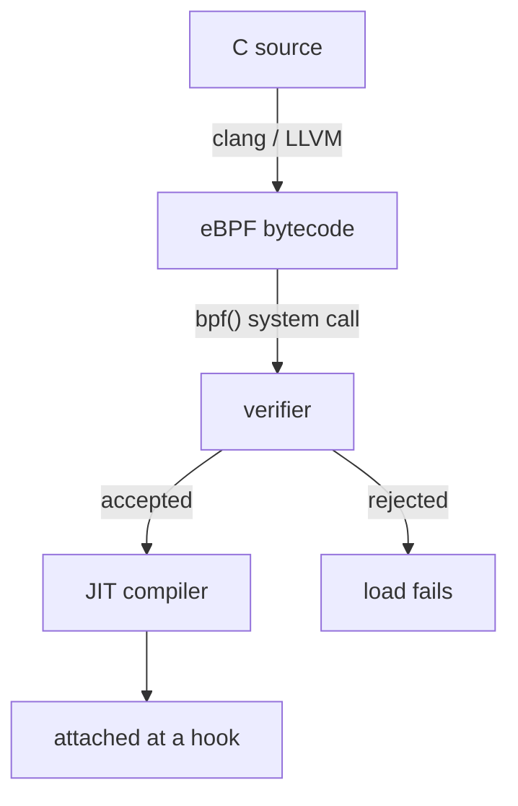

# What An eBPF Program Is And How It Reaches The Kernel

A Linux kernel does its work in fixed code. When a packet arrives, the kernel runs the code that its developers wrote and compiled into the kernel image. To change that behavior, you used to patch the kernel or load a kernel module. Both are risky, because a mistake in that code can crash the whole machine. This part explains eBPF, the mechanism that lets you add small programs to a running kernel without that risk, and it follows one program from source code to execution.

## What eBPF is

eBPF is a technology in the Linux kernel that runs small, sandboxed programs inside the kernel when a defined event happens. The name comes from Extended Berkeley Packet Filter, but the technology is now much larger than packet filtering, and most documents simply write "eBPF". An eBPF program is a list of instructions for a virtual machine that lives in the kernel. The program does not get a free hand: the kernel checks it before it runs, and it can only use a fixed set of kernel functions.

Cilium is a networking, security and observability project for Kubernetes. Its agent loads eBPF programs into the kernel of every node. Those programs decide where a packet goes, whether a connection to a Service is allowed, and what event to report. You need to know how an eBPF program is built and loaded, because every Cilium behavior in this course comes from such programs.

## From source code to a running program

A developer writes an eBPF program in a restricted form of the C language. A compiler (clang with the LLVM back end) turns that code into eBPF bytecode, which is the instruction set of the in-kernel virtual machine. The compiler stores the bytecode in an object file together with the definitions of the maps the program uses. A map is a data structure in kernel memory that the program and user space programs can both read and write, and maps are explained below.

A user space program then loads the object file. User space means ordinary processes outside the kernel. The loader calls the `bpf()` system call, which is the single entry point the kernel offers for loading programs, creating maps and reading or writing map entries. In the Cilium case, the loader is the Cilium agent running in a pod on each node.



The diagram shows the path of one program: it is compiled, submitted through the `bpf()` system call, checked by the verifier, translated to machine code and attached to a hook, which is the place in the kernel where it will run.

## The verifier decides whether a program may load

Before the kernel accepts a program, the verifier analyzes every possible path through its instructions. The verifier is a component of the kernel that proves a program is safe to run. It checks that the program ends, so it cannot hang the kernel in an endless loop. It checks that every memory access stays inside memory the program is allowed to touch, and that the program reads a pointer only after it has checked that the pointer is valid. It also checks that the program calls only the helper functions that its program type allows. A helper function is a function that the kernel exposes to eBPF programs, for example to look up an entry in a map.

If any check fails, the `bpf()` call returns an error and the program is not loaded. This is the central safety property of eBPF. A kernel module that contains a bad pointer can crash the machine, while an eBPF program with a bad pointer never starts. The limit has a price: a program must be written so that the verifier can prove it safe. This is why eBPF programs are small and have bounded loops.

The verifier proves memory safety and termination. It does not prove that the program does what the administrator wants. A program that allows every connection is perfectly safe for the kernel, so the verifier accepts it. Keep this difference in mind: safe to run is not the same as correct policy.

## Just-in-time compilation

After the verifier accepts a program, the kernel can translate the bytecode to native machine code for the processor of the node. This step is called just-in-time (JIT) compilation. The result runs at about the speed of code compiled into the kernel. On kernels where the JIT compiler is enabled, an eBPF program therefore does not pay for running inside a virtual machine.

## Privileges and kernel support

Loading a program changes the behavior of the kernel, so the kernel requires privileges. A process needs capabilities such as `CAP_BPF` and `CAP_NET_ADMIN`, or `CAP_SYS_ADMIN` on older kernels. A capability is one specific privilege that Linux can give to a process instead of full root rights. The Cilium agent pod runs with these capabilities. An ordinary application pod has none of them and cannot load programs.

Features also depend on the kernel version. Newer kernels add program types, map types and helper functions. Cilium checks what the kernel of each node supports and enables features that the node can run. Two nodes with different kernels can therefore have different datapath features in the same cluster. A feature that works on one node may not be available on another.

Programs also need to match the kernel they run on. eBPF programs can read kernel structures whose layout changes between versions. BTF (BPF Type Format) is a compact description of the kernel's own data types, and CO-RE (Compile Once, Run Everywhere) uses it to adjust a precompiled program to the running kernel at load time. Depending on the Cilium release, the agent loads precompiled objects and sets values per endpoint at load time, or compiles parts of the datapath on the node.

## A worked example of a rejected program

Take a program that reads the first byte of a packet. The context gives the program two pointers: one to the start of the packet data and one to its end. If the program reads the byte at the start without comparing the length first, the packet could be empty, and the read would touch memory that does not belong to the packet.

The verifier follows every path through the instructions. On the path where the length was never checked, it sees a read that may go past the end. It rejects the program, and the `bpf()` call returns an error. The developer must add a check that compares the start pointer plus one byte with the end pointer. With that check in place, every path is safe, and the verifier accepts the program.

This example shows why eBPF code looks defensive. Each pointer access needs a bounds check, and each loop needs a limit the verifier can see. Cilium's datapath code follows these rules, and the Cilium project tests that its programs load on the kernel versions it supports.

## Try it on the playground

The playground is a two-node `kind` cluster, a Kubernetes cluster whose nodes run as containers, with Cilium installed. The Cilium agent runs in a pod of the `cilium` DaemonSet in `kube-system`. Run the next commands from your own terminal. First read the kernel version of the node that runs the agent, because it limits which eBPF features Cilium can use:

<!-- astrona:playground:renew -->

```sh
kubectl -n kube-system exec ds/cilium -c cilium-agent -- uname -r
```

The command prints the version of the kernel of the node. All kind nodes on one machine share the kernel of that machine, so the value depends on your host.

Next, ask the agent for its own summary. The `cilium-dbg status` command reports the state of the datapath, and the line that starts with `KubeProxyReplacement` and the lines about the host firewall and BPF maps tell you which features the agent switched on:

```sh
kubectl -n kube-system exec ds/cilium -c cilium-agent -- cilium-dbg status
```

The kernel keeps loaded programs and maps alive for as long as something holds a reference to them. Cilium pins its maps as files on the BPF file system, a special file system that the agent pod mounts at `/sys/fs/bpf`. List that directory to see that maps exist as files:

```sh
kubectl -n kube-system exec ds/cilium -c cilium-agent -- ls /sys/fs/bpf
```

The listing shows what the agent pinned. Later steps read the content of these maps.

## What you now know

An eBPF program is bytecode that the kernel verifies, translates to machine code and attaches to a hook. The verifier guarantees safe execution, but not correct intent, and loading needs privileges that only the Cilium agent pod holds. The remaining question is where in the kernel a program can run and how it keeps state.

## Common pitfalls

> [!WARNING]
> Do not treat "the verifier accepted the program" as proof that a network policy is correct. The verifier checks safety of execution only. Also do not assume every node supports every eBPF feature: the kernel version and configuration of each node decide what Cilium can enable.
