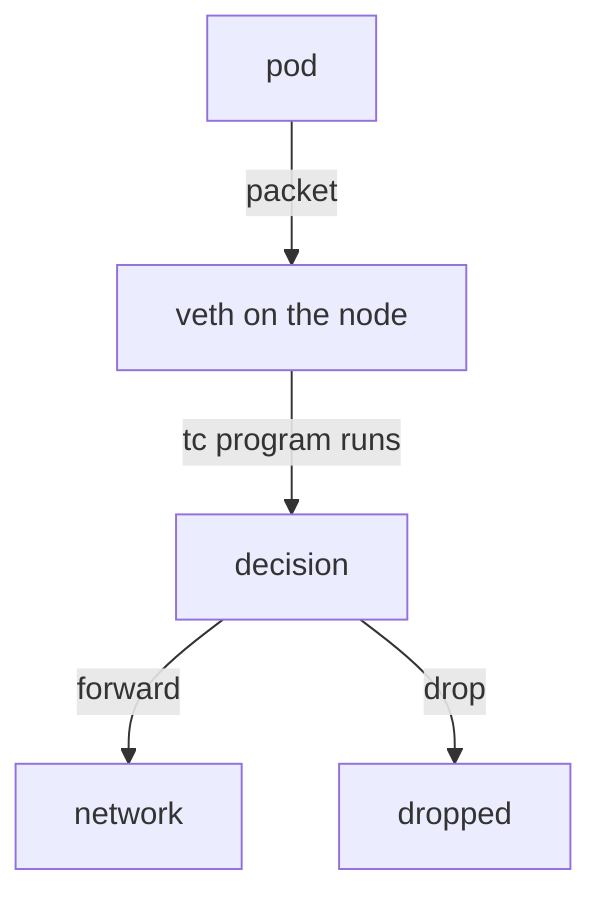
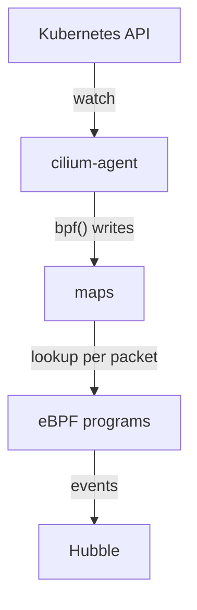

# Hooks And Maps: Where Programs Run And Where They Keep State

An eBPF program does nothing until the kernel runs it, and it can only make a useful decision if it can look something up. A packet program that must decide where to send a request to a Service needs the list of pods behind that Service. This part explains the two things that make this possible: hooks, which are the places where programs run, and maps, which are the places where programs keep data.

## Hooks

A hook is a defined point in the kernel where an eBPF program can be attached. When the kernel reaches that point, it runs every program attached there and passes the program a context. The context is a structure that describes the event, for example the packet that just arrived. Each hook accepts only one kind of program, called a program type, and each program type may call only certain helper functions.

Cilium attaches programs to several hooks. Each hook sees a different part of the traffic, so the hook decides what a program can do.

| Hook | Where it runs | What Cilium uses it for |
| --- | --- | --- |
| tc (traffic control) ingress and egress | On a network interface, after the kernel has built the packet structure | Policy and forwarding for pod traffic on the virtual interface of each pod, and on node interfaces |
| XDP (eXpress Data Path) | In the network driver, before the kernel allocates the packet structure | Optional early handling of external traffic, for example dropping or load balancing |
| Socket address hooks (cgroup `connect`, `sendmsg`, `bind`) | When an application calls `connect()` or sends a datagram | Translating a Service address to a pod address before any packet exists |
| Socket operations and socket message hooks | On established TCP sockets | Optional acceleration of traffic between sockets on one node |

The tc hook is the most important one for Cilium. Every pod on a node has a virtual interface, a veth pair, with one end in the pod and the other end on the node. Cilium attaches a program to the node end of that pair. Every packet that leaves a pod or enters a pod passes that program.



The diagram shows that the program on the node end of the virtual interface sees each packet from a pod and returns one decision: forward it or drop it.

## Why the hook decides what a program sees

A socket hook runs before the application sends any packet. At that point the program sees the destination address that the application asked for, which for a Service is the cluster IP. It can replace that address with the address of a pod, and the application then sends its packets directly to the pod. A tc program, in contrast, sees finished packets. It can read the source and destination addresses and ports, but it does not know which application function made the call.

For this reason a statement such as "Cilium inspects packets with eBPF" is incomplete. A Service lookup can happen at the socket hook. A policy decision happens at the tc hook of the pod interface. Early dropping of external traffic can happen at XDP. To diagnose a problem, first decide which hook is responsible.

## Maps

A map is a data structure in kernel memory that holds key and value pairs. A program cannot keep state in ordinary variables between runs, because each run starts fresh. Maps solve this: the program reads and writes the map, and so can a user space program through the `bpf()` system call. This is how the Cilium agent in user space gives configuration to the programs in the kernel.

The kernel offers several map types. A hash map finds a value by key in constant time, which means the time does not grow with the number of entries. An array map uses a number as index. An LRU (least recently used) hash map removes the oldest entries when it is full, which suits tables such as connection tracking. An LPM (longest prefix match) trie matches an address against a list of networks, and a ring buffer or perf event map sends events from the kernel to user space.

Every map has a fixed maximum size that is set when the map is created. A full map rejects new entries. That is a real failure case in large clusters, and it is why Cilium sizes some maps from the amount of memory of the node.

## Maps that Cilium uses

Cilium keeps most of its datapath state in maps. The exact names depend on the release, so always list them on your own cluster. These are the groups you will meet:

- Service maps hold the frontends (the Service address and port) and the backends (the pod addresses behind a Service). The IPv4 service map has `lb4_services` in its name.
- An endpoint map holds the local pods and their identities.
- An IP cache map translates an IP address to the numeric security identity of the workload behind it.
- Policy maps hold, for each local endpoint, the identities and ports that policy allows.
- A connection tracking map remembers established connections.
- Event maps carry drop, trace and policy verdict events to user space, where Hubble reads them.

The data flow is always the same. The agent watches the Kubernetes API, computes the result, and writes it into maps. The programs in the kernel read the maps for every packet and never call the Kubernetes API.



The diagram shows that the agent is the writer of the maps and the programs are the readers, with events flowing back to user space.

## Try it on the playground

Cilium has a command to list the maps that the agent has open. Use it to see the names on your cluster:

<!-- astrona:playground:renew -->

```sh
kubectl -n kube-system exec ds/cilium -c cilium-agent -- cilium-dbg map list
```

The output has one row per map with its name and number of entries. Find the row with `lb4_services` in its name. The Service `probe` in `starfleet` has a cluster IP. Read that address and the addresses of the pods behind it:

```sh
kubectl -n starfleet get service probe -o wide
kubectl -n starfleet get pods -l app=probe -o wide
```

Now print the content of the service maps. The command `cilium-dbg bpf lb list` prints frontends with their backends:

```sh
kubectl -n kube-system exec ds/cilium -c cilium-agent -- cilium-dbg bpf lb list
```

Look for the cluster IP of `probe` with port 80, and for the pod address with port 8080 next to it. This is the programmed state: the Kubernetes Service object says what you want, and this map says what the kernel programs use. The agent also keeps a map of local endpoints, which you can print with the next command:

```sh
kubectl -n kube-system exec ds/cilium -c cilium-agent -- cilium-dbg bpf endpoint list
```

## Map state can differ from the Service object

The programs read the map, not the Service object. If the agent stops updating, for example because it lost its connection to the Kubernetes API, the map can show an old backend list. A program with a correct logic then forwards traffic to a pod that no longer exists. When a Service behaves in a way the object does not explain, compare the object with the map.

## What you now know

Hooks decide when and where a program runs and what it can see. Maps hold the state that programs read for every packet, and the Cilium agent writes that state from the Kubernetes API. The remaining question is how the agent turns pods, labels and policies into that state.

## Common pitfalls

> [!WARNING]
> Map names and layouts change between Cilium releases, so do not copy a name from a blog post into a script without listing the maps first. A map has a fixed size: a full map rejects new entries even when the program is fine. Do not read the Service object as proof of the datapath state; read the map.
