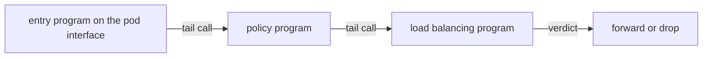

# Program Types, Tail Calls And bpftool

A kernel can run eBPF programs at many places, but one program cannot do everything. A packet program has different needs from a program that watches a system call. This part explains program types, which decide where a program can attach and what it may do, shows how Cilium chains programs with tail calls, and introduces `bpftool`, the tool that lists what is loaded in a kernel.

## Program types

Every eBPF program has a program type. The type is chosen when the program is loaded. It fixes three things: the hooks where the program can attach, the context structure that the program receives, and the helper functions that the program may call. A helper is a function that the kernel provides to eBPF programs, for example a function that looks up a map entry or redirects a packet.

These are the program types that matter for Cilium:

| Program type | Kernel name | Hook | What Cilium does with it |
| --- | --- | --- | --- |
| Traffic control classifier | `SCHED_CLS` | tc ingress and egress on an interface | Policy, forwarding and load balancing on pod and node interfaces |
| Express Data Path | `XDP` | Network driver receive path | Optional early load balancing and filtering of external traffic |
| Socket address | `CGROUP_SOCK_ADDR` | `connect()`, `sendmsg()`, `bind()` calls of processes in a cgroup | Translate a Service address to a pod address |
| Socket operations | `SOCK_OPS` | TCP socket events | Socket-level acceleration on one node |
| Socket message | `SK_MSG` | `sendmsg()` on selected sockets | Redirect data between local sockets |

Other types exist, for example `KPROBE` and `TRACEPOINT` for tracing. Tools that use eBPF for observability and runtime security attach programs of those types. Which types a node supports depends on its kernel version.

A cgroup (control group) is a Linux kernel feature that groups processes. Cilium attaches its socket address programs to the root cgroup, so the programs run for every process on the node. Newer releases can attach tc programs with the `tcx` attach type on kernels that support it, and use the older tc attach method on other kernels. The agent chooses the method; you do not configure it per program.

## The bpf() system call and file descriptors

A user space program talks to eBPF only through the `bpf()` system call. The commands of that call load a program, create a map, read or write a map entry and attach a program to a hook. Each loaded program and each map is a kernel object, and the loader gets a file descriptor for it. When the last reference to an object disappears, the kernel frees it.

An attached program keeps itself alive through its hook, but a map can disappear when no process holds it. To avoid this, a loader can pin an object. Pinning means that the kernel makes the object visible as a file in a special file system called `bpffs`. By convention `bpffs` is mounted at `/sys/fs/bpf`.

Cilium pins its maps under `/sys/fs/bpf`. The pinned maps survive when the agent process stops. This is the reason why traffic keeps flowing when the agent restarts: the programs stay attached to their hooks and the pinned maps keep their content.

## Tail calls

The verifier limits how complex one program may be. Cilium has many features, and a single program that holds all of them would be too large. Cilium splits the datapath into several programs and jumps between them with tail calls.

A tail call is a helper call, `bpf_tail_call()`, that replaces the running program with another program and does not return. The target programs are stored in a map of the type `PROG_ARRAY`. The calling program gives the map and an index, and the kernel continues with the program at that index. The kernel limits a chain to 33 tail calls so that a loop cannot run forever.



The diagram shows one entry program that hands the packet to further programs through a program array, until one of them returns a verdict.

Tail calls also let the agent change behavior without a new attachment. The agent can write a different program into a slot of the program array, and the next packet follows the new path.

## Looking at the kernel with bpftool

`bpftool` is the standard command line tool to inspect eBPF objects. It reads kernel data and does not depend on Cilium. The Cilium agent image includes it, so you can run it in an agent pod and see the programs and maps of that node.

<!-- astrona:playground:renew -->

List the loaded programs. Look for the types `sched_cls` and `cgroup_sock_addr` and for names that start with `cil_`:

```sh
kubectl -n kube-system exec ds/cilium -c cilium-agent -- bpftool prog show
```

List the maps, and then show which interfaces have a program attached:

```sh
kubectl -n kube-system exec ds/cilium -c cilium-agent -- bpftool map show
kubectl -n kube-system exec ds/cilium -c cilium-agent -- bpftool net show
```

The `net show` output groups attachments by interface. Find the interfaces named `lxc` followed by letters and digits. Those are the node ends of the pod virtual interfaces, and each has a tc program. To see the instructions of one program, take its id from `prog show` and dump it:

```sh
kubectl -n kube-system exec ds/cilium -c cilium-agent -- bpftool prog dump xlated id <id>
```

Replace `<id>` with a real program id. The output is long, so use it to read the shape of a program and not to learn every line. To see the content of a map, use `bpftool map dump id <id>` with an id from `map show`. For Cilium maps, `cilium-dbg` prints the same data in a readable form and is easier to use.

## What you now know

A program type fixes the hook, the context and the helpers of a program. Cilium uses tc, XDP and socket programs. Pinned maps in `bpffs` outlive the agent process, and tail calls let Cilium split a large datapath into programs that the verifier accepts. `bpftool` shows the programs and maps that a kernel holds. The next question is which kernel features a node needs so that Cilium can load all of this.

## Common pitfalls

> [!WARNING]
> Do not use `bpftool` to change maps that the agent manages. The agent can overwrite your change, and a wrong entry can break traffic on the node. Use `bpftool` to read. Program and map names differ between Cilium releases, so list them on your own cluster before you write a filter in a script.
