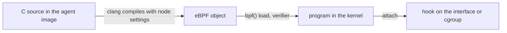

# Kernel Requirements, BTF And How Cilium Builds Its Programs

An eBPF program runs in the kernel of one specific node. Kernels differ in version, configuration and in the structures they use inside. This part explains what Cilium needs from a kernel, how an eBPF program can adapt to differences, and how the agent builds the programs for a node.

## What Cilium needs from the kernel

Cilium depends on eBPF features that older kernels do not have. The Cilium documentation lists a minimum Linux kernel version in its system requirements, and the minimum rises over time. Check the page for the release you install. Some features need a newer kernel than the minimum. For example, some load balancing and routing features need a kernel that supports particular helper functions or attach types.

The kernel must also be built with the right options. These include the eBPF system call, the tc classifier support, cgroup support and BTF information. A distribution that is built for containers normally has them. A very small or custom kernel may not.

You can read the kernel version of every node from Kubernetes:

<!-- astrona:playground:renew -->

```sh
kubectl get nodes -o wide
```

The column `KERNEL-VERSION` shows the version. On `kind`, all nodes are containers that share the kernel of your machine or of the virtual machine that runs Docker, so they show the same version.

## Feature detection at startup

The agent does not assume that all features exist. At startup it probes the kernel: it tries to load small test programs and to create maps of the types it wants. From the results it decides which datapath features it can enable. If you ask for a feature that the kernel cannot support, the agent reports an error or falls back, depending on the setting.

The agent writes its view of the node in its status output. This command prints a detailed report. Look at the lines about the datapath mode, the routing, the kube-proxy replacement mode and the attached features:

```sh
kubectl -n kube-system exec ds/cilium -c cilium-agent -- cilium-dbg status --verbose
```

When a feature does not work on one node but works on another, compare the kernel versions first. Nodes in one cluster can run different kernels, and the agent decides per node.

## BTF and CO-RE

Kernel data structures change between versions. A field can move, and an eBPF program that reads it by a fixed offset would read wrong data. BTF (BPF Type Format) solves part of this. BTF is a compact description of the types and structures of a program or of the kernel. A kernel built with BTF exposes the description of its own types in the file `/sys/kernel/btf/vmlinux`.

CO-RE (Compile Once, Run Everywhere) uses BTF. The compiler records which structure fields a program wants, and the loader library adjusts the field offsets to the running kernel when it loads the program. The same compiled object then works on several kernel versions. Check whether a node exposes BTF:

```sh
kubectl -n kube-system exec ds/cilium -c cilium-agent -- ls -l /sys/kernel/btf/vmlinux
```

A missing file means that the kernel has no BTF. Tools that rely on CO-RE then cannot load their programs on that node. Much of the Cilium datapath works with the packet structure and with maps that Cilium defines itself, so it depends less on kernel internal structures than tracing tools do.

## How the agent builds the datapath programs

The datapath programs of Cilium are written in C. The agent image contains the source files, the LLVM compiler and the tools to load objects. The agent compiles the programs on the node when it starts and when an endpoint needs a new set of settings. The compiler writes eBPF object files. The agent then loads each object with the `bpf()` system call and attaches it.



The diagram shows the order on the node: compile, load through the verifier and attach.

The node settings reach the program as compile time constants. Examples are the address of the node, the interface index and feature switches. A change such as a new device or a different feature setting makes the agent compile and load the program again. The agent replaces the program on the hook, and the old program runs until the new one is in place. That is why reconfiguration does not cut traffic.

You can see how many endpoints the agent regenerated and whether a build failed in the agent log:

```sh
kubectl -n kube-system logs ds/cilium -c cilium-agent --tail=50
```

Look for messages about regeneration or about a failed build. A build or verifier failure appears there with the reason, and the endpoint stays on its previous programs.

## Verifier limits that shape the design

The verifier rejects a program that is too complex, that has a path it cannot prove, or that uses a feature the kernel lacks. Cilium keeps its programs within these limits by splitting them with tail calls and by compiling out code for disabled features. A feature that is off at compile time does not exist in the program, so it costs nothing per packet and cannot fail verification.

## What you now know

Cilium needs a kernel of the minimum version of its release and the right build options. The agent probes the kernel at startup and enables only what works. BTF and CO-RE let programs adapt to kernel differences. The agent compiles the C datapath with node settings, loads the result through the verifier and replaces programs on the hooks without a pause in traffic. The question that remains is how the agent knows what a program should contain, which depends on pods and policies and is the subject of the next module.

## Common pitfalls

> [!WARNING]
> Do not assume that all nodes in a cluster have the same kernel and the same features. Do not install Cilium without reading the system requirements of the exact release. A feature that works on a test cluster with a new kernel can fail on production nodes with an older kernel.
