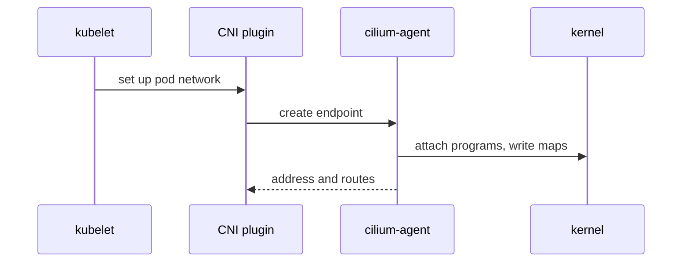
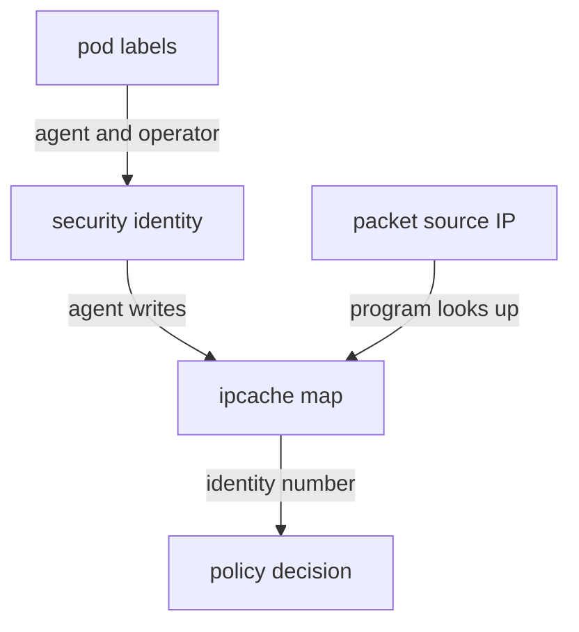

# The Cilium Agent, Endpoints And Identities

The kernel can run eBPF programs, but it does not know what a pod, a label or a Kubernetes Service is. Something must translate Kubernetes objects into program state. This part introduces the components of Cilium that do this work, follows what happens when a pod starts, and explains security identities, the idea that lets Cilium write policy by labels instead of by IP addresses.

## The components

Cilium consists of a few programs that run as pods. Each one has a clear job.

- The Cilium agent (`cilium-agent`) runs as a DaemonSet, so one agent pod runs on every node. It watches the Kubernetes API, loads the eBPF programs on its node, writes the maps and answers the local `cilium-dbg` commands.
- The Cilium operator (`cilium-operator`) runs as a Deployment. It does tasks that are done once for the cluster, for example garbage collection of unused identity objects and, in some IP address management modes, allocating pod address ranges to nodes.
- The Cilium CNI plugin is a small binary on each node. CNI (Container Network Interface) is the standard through which the container runtime asks a plugin to set up networking for a pod. The plugin passes the request to the local agent.
- Hubble is the observability layer inside the agent. Hubble Relay is an optional Deployment that collects flows from all agents.

A DaemonSet is a Kubernetes object that runs one pod on every node. The agent must run on each node because the eBPF programs and maps it writes are part of the kernel of that node.

## What happens when a pod starts

Take the `shuttle` pod. The kubelet, the node agent of Kubernetes, asks the container runtime to start the pod. The runtime calls the CNI plugin. The plugin creates a virtual interface pair (veth), puts one end in the pod and leaves the other end on the node. It then asks the Cilium agent to create an endpoint for the pod.



The diagram shows that the CNI plugin does the interface work, and the agent does the part that involves eBPF: attaching programs to the new interface and writing the map entries for the new endpoint.

An endpoint is the Cilium object for one pod network interface. It has a numeric endpoint ID that is local to the node, an IP address, the labels of the pod and a security identity. The agent publishes each endpoint to the Kubernetes API as a `CiliumEndpoint` resource, so you can read it with `kubectl`.

## Security identities

Pod IP addresses change every time a pod is replaced. A rule such as "allow traffic from 10.244.1.17" breaks as soon as the pod restarts. Cilium instead gives each group of pods with the same security-relevant labels a numeric security identity. A security identity is a number that stands for one set of labels, for example the labels of the `shuttle` pods in `starfleet`.

All pods with the same labels share one identity, even when there are ten of them on five nodes. Cilium takes the labels that matter for policy, such as the pod labels and the namespace, and the operator and agents allocate the number. The identity is stored in a `CiliumIdentity` resource. A pod that gets new labels gets a different identity.

The agent also keeps an IP cache map that translates an IP address to an identity. When a packet arrives, the program looks up the source address in the IP cache and learns the identity of the sender. Policy compares that number, not the address. When a packet travels between nodes, Cilium also carries the identity of the sender in the tunnel header or in a mark on the packet, so the receiving node does not need to look it up again in the common case.



The diagram shows how labels become a number, how the number is stored together with the address, and how a program turns a source address back into that number.

## Try it on the playground

Look at the endpoints that Kubernetes knows about. The `CiliumEndpoint` objects are in the same namespace as the pods:

<!-- astrona:playground:renew -->

```sh
kubectl -n starfleet get ciliumendpoints
```

Each row names a pod and shows its identity ID and its endpoint state. Read the full object of the `shuttle` pod. First save its name:

```sh
SHUTTLE_POD=$(kubectl -n starfleet get pods -l app=shuttle -o jsonpath='{.items[0].metadata.name}')
echo "$SHUTTLE_POD"
```

Then print the identity and the endpoint ID from the `CiliumEndpoint`:

```sh
kubectl -n starfleet get ciliumendpoint "$SHUTTLE_POD" -o jsonpath='{.status.identity.id}{"\n"}{.status.id}{"\n"}'
```

The first number is the security identity and the second is the endpoint ID on its node. Now read the identity object itself with the number you just printed. Replace `<IDENTITY>` with that number:

```sh
kubectl get ciliumidentity <IDENTITY> -o yaml
```

The `security-labels` field of the object lists the labels that the identity stands for. Finally, ask the agent for its local view of all endpoints on its node:

```sh
kubectl -n kube-system exec ds/cilium -c cilium-agent -- cilium-dbg endpoint list
```

The table lists the endpoints of that node with their endpoint ID, identity, labels and IP address. The agent you reached with `ds/cilium` shows only the pods of its own node, so pods on the other node do not appear in that table.

## Identities and the drifter

The `drifter` pod runs in the `outpost` namespace. Its labels include a different namespace, so Cilium gives it a different identity from `shuttle`, even though both pods use the same container image and similar labels. This is what makes a rule such as "allow only pods with the label `app=shuttle` in `starfleet`" precise: another namespace cannot match it by using the same label.

## What you now know

The agent on each node connects Kubernetes to the kernel: it creates endpoints, assigns identities and writes maps. Identities replace IP addresses as the subject of policy, which keeps rules valid when pods are replaced. The remaining question is how a policy that names identities becomes a decision on a packet.

## Common pitfalls

> [!WARNING]
> `cilium-dbg endpoint list` through `ds/cilium` shows only the node of the agent pod that `kubectl` picked, so a pod you cannot find may run on another node. Identities come from labels, so changing a label on a pod changes its identity and can change which policy applies.
