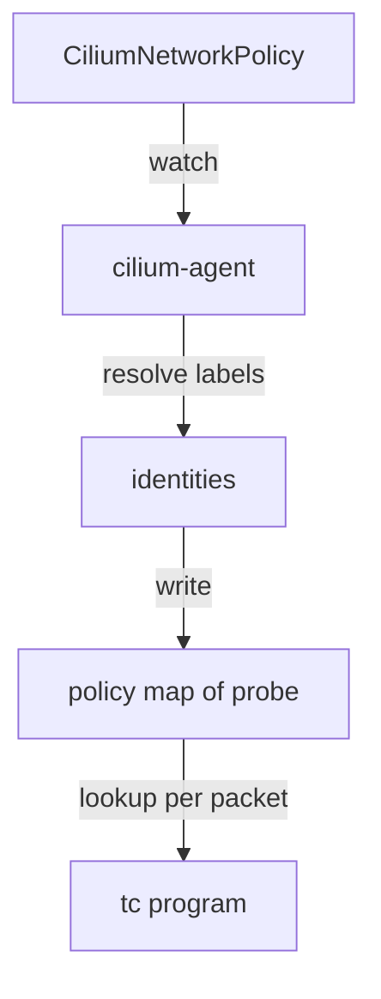

# How Cilium Enforces Policy And Load Balances Services With eBPF

By default every pod in a Kubernetes cluster can reach every other pod. To limit that, you write a network policy. This part follows a policy from the YAML you apply to the decision a program makes on a packet, and then shows how the same mechanism of agent, maps and programs also performs Service load balancing and reports events.

## Policy starts as a Kubernetes object

Cilium accepts the standard Kubernetes `NetworkPolicy` and its own `CiliumNetworkPolicy` resource. The Cilium resource adds features such as rules at layer 7, which is the application protocol level, and matching by DNS name. Both describe which sources may reach which pods. A policy has an `endpointSelector` that picks the pods it protects, and lists of ingress or egress rules.

Here is a policy for the `probe` pods. It allows requests only from pods with the label `app: shuttle`, and only to port 8080, which is the port the `probe` container listens on. Save this as `ciliumnetworkpolicy-probe.yaml`:

```yaml
apiVersion: cilium.io/v2
kind: CiliumNetworkPolicy
metadata:
  name: probe-from-shuttle
  namespace: starfleet
spec:
  endpointSelector:
    matchLabels:
      app: probe
  ingress:
    - fromEndpoints:
        - matchLabels:
            app: shuttle
      toPorts:
        - ports:
            - port: "8080"
              protocol: TCP
```

A policy that selects a pod turns on enforcement for that pod in the direction it mentions. After that, ingress traffic to `probe` is denied unless a rule allows it. This is the default-deny behavior: the first policy that selects an endpoint switches it from "everything allowed" to "only what is allowed".

## From the policy to a map entry

The agent on each node watches `CiliumNetworkPolicy` objects. For each local endpoint that a policy selects, the agent resolves the rule. It finds the security identities that match `app: shuttle` and writes entries into the policy map of that endpoint. One entry holds an identity, a port, a protocol and a direction, and the verdict, which is allow or deny.



The diagram shows that the policy never reaches the kernel as text. The agent resolves it to identities first, and only identities, ports and verdicts reach the map.

## What the program does with a packet

When a packet for `probe` arrives, the tc program on the virtual interface of the `probe` pod runs. It looks up the source address in the IP cache to get the identity. It then looks up the key of identity, port and protocol in the policy map of the endpoint. If an entry allows the key, the program lets the packet pass. If no entry matches, the program drops the packet and emits a drop event that Hubble can read.

Two details are easy to miss. First, a policy port is the port of the pod, after Service translation. The Service `probe` listens on port 80 and forwards to the container port 8080, so a rule for port 80 never matches. Second, the decision applies to new connections. Cilium tracks connections, so reply packets of an allowed connection are allowed automatically.

For a node that has the source pod and the destination pod, the program on the destination interface decides. For a pod on another node, the packet arrives through the tunnel or the routed network and the program at the destination interface still decides, using the identity the packet carries or the one in the IP cache.

## Service load balancing uses the same pieces

The service map is the same idea. The agent watches Services and EndpointSlices, which are the Kubernetes objects that list the pod addresses behind a Service. It writes one frontend entry for each Service address and port, and one backend entry for each pod. When a pod connects to the cluster IP of `probe`, a program picks one backend from the map and the connection goes to the pod. The Service object is not involved at that moment.

Policy and load balancing compose in a fixed order. The destination of the connection is translated first, so the policy sees the pod address and the pod port. This is why the rule above names port 8080.

## What eBPF does not do alone

eBPF programs are good at fast decisions on addresses, ports and identities. They are not a full application server. Rules at layer 7, for example "allow only `GET /status`", need an HTTP parser. Cilium redirects such traffic to an Envoy proxy that runs in the agent or as its own pod, and that proxy applies the rule. The eBPF programs still do the redirect. Also, the kernel's own routing and connection tracking code still run for traffic that eBPF does not handle.

## Try it on the playground

First test the starting state. With no policy, both clients reach the `probe` Service. The `curl` option `-m 5` limits the request to five seconds and `-w` prints the HTTP status code:

<!-- astrona:playground:renew -->

```sh
kubectl -n starfleet exec deploy/shuttle -- curl -s -m 5 -o /dev/null -w '%{http_code}\n' http://probe.starfleet.svc/status/200
kubectl -n outpost exec deploy/drifter -- curl -s -m 5 -o /dev/null -w '%{http_code}\n' http://probe.starfleet.svc/status/200
```

Both commands should print the HTTP status code 200. Apply the policy you saved earlier:

```sh
kubectl apply -f ciliumnetworkpolicy-probe.yaml
```

Then send the same two requests again. The one from `shuttle` still succeeds. The one from `drifter` has no matching rule, so the program drops its packets, and `curl` stops after five seconds with no status code. Next, look at the enforcement state and the policy map entries on the node of the `probe` pod. The first command lists the endpoints with an enforcement column, and the second command prints the policy map content for all local endpoints:

```sh
kubectl -n kube-system exec ds/cilium -c cilium-agent -- cilium-dbg endpoint list
kubectl -n kube-system exec ds/cilium -c cilium-agent -- cilium-dbg bpf policy get --all
```

If the table of the agent you reached does not show `probe`, the pod runs on the other node. Find the node with `kubectl -n starfleet get pods -l app=probe -o wide` and run the command in the agent pod on that node.

## What you now know

A policy is a Kubernetes object that the agent resolves to identities, ports and verdicts in a per-endpoint map. The tc program on the pod interface looks the packet up in that map, so enforcement needs no change to the application and no IP address in the rule. Service load balancing works the same way with the service map, and layer 7 rules add a proxy. The remaining question is how much this design improves on the iptables-based model that Kubernetes uses by default.

## Common pitfalls

> [!WARNING]
> Write the pod port in policy rules, not the Service port. A policy that selects a pod denies all ingress that no rule allows, including traffic from other namespaces. Policy enforcement is visible only on the node of the protected pod, so look at the agent on that node.
