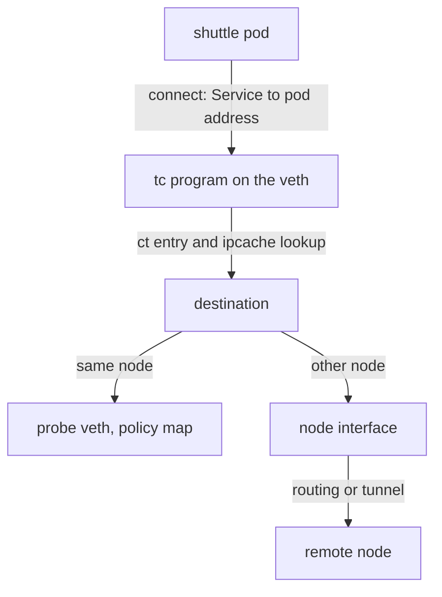

# Connection Tracking And The Path Of A Request Between Pods

A policy that checks every packet would also have to allow every reply packet by hand. Cilium avoids this with connection tracking. This part explains what connection tracking does in the eBPF datapath, follows one request from the `shuttle` pod to the `probe` pod step by step, and explains the two ways that Cilium can carry traffic between nodes.

## Connection tracking in eBPF

Connection tracking (conntrack) records the state of each connection: which addresses and ports it uses, which direction opened it and whether it is established. Cilium keeps its own connection tracking table in eBPF maps. It does not use the connection tracking of the Linux netfilter framework for this. Cilium uses separate maps for TCP and for other protocols, and the maps are sized from the memory of the node.

The first packet of a new connection has no entry. The program evaluates policy, and if policy allows the packet, it creates an entry. The packets that follow in the same connection find the entry and skip the policy lookup. Reply packets match the same entry in reverse, so a reply needs no rule. This is why a policy that allows `shuttle` to reach `probe` does not need a second rule for the response.

An entry expires after a timeout when the connection ends or stays idle. When the connection tracking map is full, Cilium can run garbage collection and may fail to create new entries under extreme load.

<!-- astrona:playground:renew -->

Send a request and then read the table. The first command makes a connection, and the second prints the global table of the agent. Because the table holds all connections of the node, filter the output with the address of the `probe` pod:

```sh
kubectl -n starfleet exec deploy/shuttle -- curl -s -m 5 -o /dev/null http://probe.starfleet.svc/status/200
kubectl -n starfleet get pods -l app=probe -o wide
kubectl -n kube-system exec ds/cilium -c cilium-agent -- cilium-dbg bpf ct list global
```

Use the pod IP from the second command to find the matching entries. If the `shuttle` pod and the `probe` pod run on different nodes, the entry exists on both nodes, so check the agent that runs on each of them.

## The path of one request

Follow the request `curl http://probe.starfleet.svc` from the `shuttle` pod. The steps happen in this order:

1. The curl process calls `connect()` on the cluster IP of the `probe` Service. The socket address program of Cilium replaces the cluster IP and port 80 with the address of one `probe` pod and port 8080. No packet exists yet.
2. The pod sends the first TCP packet to the pod address. It leaves through its virtual interface and reaches the tc program on the node end of the interface. This program, named `cil_from_container` in current releases, looks up the destination in the IP cache to learn whether the address is a local endpoint, a remote pod or something else.
3. The program checks the connection tracking table and creates an entry for the new connection.
4. If the destination is a pod on the same node, the packet goes straight to the virtual interface of the destination pod, and the program there enforces the ingress policy of the `probe` endpoint. The program that enforces ingress policy runs on the node of the protected pod.
5. If the destination is on another node, the program sends the packet out of the node interface. How it does that depends on the routing mode.
6. On the other node, a tc program on the node interface receives the packet, finds the local endpoint and hands the packet to the endpoint, where the ingress policy lookup happens.



The diagram shows that the Service address is already gone when the first packet appears, and that the destination decides whether the packet stays on the node.

## Tunnel and native routing

Traffic between nodes needs a rule for how pod addresses get across the network that connects the nodes. Cilium offers two routing modes. The Helm value is `routingMode`.

In tunnel mode, the default, Cilium wraps each pod packet in an outer packet addressed to the destination node. The outer packet uses VXLAN (Virtual Extensible LAN) or Geneve (Generic Network Virtualization Encapsulation), a UDP-based encapsulation format. The node network only needs to carry traffic between node addresses. The cost is a few bytes of header on every packet, so the pod MTU (maximum transmission unit) is smaller than the node MTU.

In native routing mode, Cilium sends pod packets without a wrapper. The network must know how to reach each node pod range, either through routes that you or a routing daemon create, or through the cloud network. You also set `ipv4NativeRoutingCIDR` so that Cilium does not masquerade traffic to those addresses. Native routing has no encapsulation cost, and it needs more preparation of the network.

You can read the active mode in the agent:

```sh
kubectl -n kube-system exec ds/cilium -c cilium-agent -- cilium-dbg status --verbose
```

Look for the routing line. The playground uses the default, so the line shows tunnel mode.

## What you now know

Cilium tracks connections in its own eBPF maps, evaluates policy on the first packet and lets reply packets match the stored entry. A request from a pod to a Service is translated at the socket, passes the tc program on the pod interface and then goes to a local pod or to another node. Between nodes, Cilium either encapsulates packets in a tunnel or routes them natively. The remaining question is how to inspect all of these objects on a live node.

## Common pitfalls

> [!WARNING]
> Do not read the Linux `conntrack` tool output and expect to see Cilium connections that never pass through netfilter. Use `cilium-dbg bpf ct list global`. Do not switch to native routing before the node network can route the pod ranges, because traffic between nodes stops. Remember that a tunnel lowers the usable MTU of pods.
