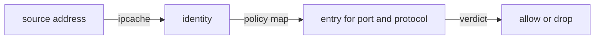

# The IP Cache And Security Identities On A Node

A packet carries an IP address, but policy compares security identities. Something on the node must translate one to the other for every packet. This part shows the IP cache map that does this, the list of identities that the agent knows, and the reserved identities that exist in every cluster.

## The IP cache

The IP cache is a BPF map that connects an IP address or a network prefix to a security identity. The agent fills it from the Kubernetes API: each pod address maps to the identity of the pod, and each node address maps to a node identity. The tc programs read the map for the source address of every packet to learn who is calling.

<!-- astrona:playground:renew -->

The commands use the shell variable `AGENT_POD`, which holds the name of the agent pod on the node you investigate. Set it with `kubectl -n kube-system get pods -l k8s-app=cilium -o name` and pick the agent of the node of the `probe` pod. Then print the whole map of the agent:

```sh
kubectl -n kube-system exec $AGENT_POD -c cilium-agent -- cilium-dbg bpf ipcache list
```

Each row has a prefix and an identity number. The rows include the pods of all nodes, not only the local ones, because a program must be able to identify a remote client. Get one entry by address when you know the pod IP:

```sh
kubectl -n kube-system exec $AGENT_POD -c cilium-agent -- cilium-dbg bpf ipcache get <pod-ip>
```

Replace `<pod-ip>` with the address of the `shuttle` pod. The identity in the result must equal the identity in the endpoint list and in the `CiliumEndpoint` object. If the IP cache shows a different number or no entry, the agent has not yet learned the pod, and policy decisions for that source use the wrong identity. A pod that was just created can be in this state for a short time.

## The list of identities

The command `cilium-dbg identity list` shows every identity that this agent knows. It prints the number, the labels that define it and a reference count, which is the number of endpoints that currently use the identity on this node.

```sh
kubectl -n kube-system exec $AGENT_POD -c cilium-agent -- cilium-dbg identity list
```

Find the identity of the `probe` pods. Its labels include `k8s:app=probe` and the namespace label `k8s:io.kubernetes.pod.namespace=starfleet`. The agent builds the identity from the labels that Cilium treats as security relevant, and it ignores labels that change often, for example the hash that a Deployment adds to the pod name. If it did not ignore them, each new ReplicaSet would create a new identity.

To look at one identity, use its number:

```sh
kubectl -n kube-system exec $AGENT_POD -c cilium-agent -- cilium-dbg identity get <identity-number>
```

## Reserved identities

Some identities are fixed and have the same number in every cluster. They describe traffic that is not an ordinary pod:

| Name | Meaning |
| --- | --- |
| `host` | The local node |
| `world` | Any address outside the cluster |
| `unmanaged` | A pod that Cilium does not manage |
| `health` | The health endpoints of Cilium |
| `init` | An endpoint whose labels the agent has not yet read |
| `remote-node` | Another node of the cluster |
| `kube-apiserver` | The Kubernetes API server, when the agent can detect it |

The `world` identity matters for policy. A rule that allows traffic from outside the cluster names `world`, or an address range with a CIDR rule. The `init` identity matters for timing. A new pod has it until the agent knows its labels, and policy treats the pod as `init` during that time.

You can print the reserved identities with the identity list, where they show with small numbers and with `reserved:` labels in the label column.

## Identity and the policy path

The identity of the source decides which policy map entry matches. The program takes the source address of the packet, looks up the identity in the IP cache, and then looks up the identity, the port and the protocol in the policy map of the destination endpoint. This is the full chain: address, identity, policy entry, verdict. When a request is dropped, you walk the chain from the left, and the first link that gives an unexpected value is the cause.



The diagram shows the three lookups that turn an address into a verdict.

## What you now know

The IP cache turns an address into an identity for every packet. The identity list shows the label sets that identities stand for, and reserved identities cover the node, the outside world and endpoints that are not ready. The question that remains is where the policy entries are stored and how connection tracking changes the verdict, which the next part reads.

## Common pitfalls

> [!WARNING]
> Do not compare identity numbers between two different clusters, because the numbers are allocated per cluster. Do not expect a label such as the pod name to change an identity, because the agent ignores labels that it does not treat as security relevant. A new pod has the `init` identity for a short time, so wait before you decide that a policy is wrong.
