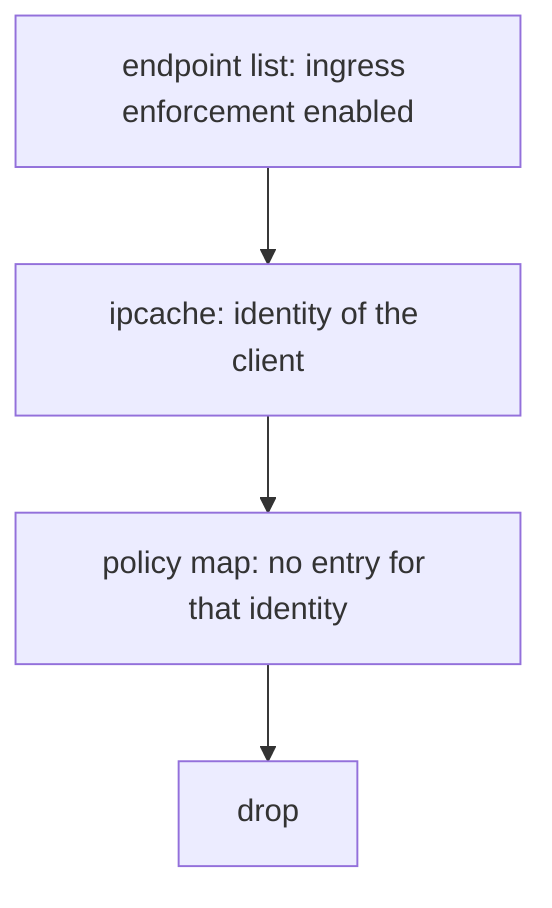

# Reading The Policy Map And The Connection Tracking Table

When a request is dropped, two tables decide the result: the policy map of the destination endpoint and the connection tracking table of the node. This part shows how to read both, how to tell an allow entry from an implicit deny and how to see which policy rules produced the entries.

## The policy map of one endpoint

Each endpoint has its own policy map. The agent builds it from all policies that select the endpoint. An entry has an identity, a port, a protocol and a direction, and it says allow or deny. The program on the endpoint interface looks up this map for every new connection.

<!-- astrona:playground:renew -->

Print the policy map of the `probe` endpoint. Use the endpoint ID from the endpoint list of the agent on the node of the `probe` pod:

```sh
kubectl -n kube-system exec $AGENT_POD -c cilium-agent -- cilium-dbg bpf policy get <endpoint-id>
```

With no policy that selects `probe`, the endpoint does not enforce ingress policy, and the map allows traffic from all identities. After you apply a policy that selects it, the map holds one entry for each allowed identity and port. Read the identity number and the port in each row, and check that the number belongs to the client you want to allow.

Add `--numeric` to the command when you want identities as numbers and not as names, which is useful when you compare against the identity list:

```sh
kubectl -n kube-system exec $AGENT_POD -c cilium-agent -- cilium-dbg bpf policy get <endpoint-id> --numeric
```

## Which rule created an entry

The map shows the result and not the reason. To see the rules in the form the agent understands, ask for the policy that the agent holds:

```sh
kubectl -n kube-system exec $AGENT_POD -c cilium-agent -- cilium-dbg policy get
```

The output is JSON and lists each rule with its endpoint selector, its labels and the name of the `CiliumNetworkPolicy` that it came from.

## Default deny in the policy columns

The endpoint list shows `Disabled` or `Enabled` in the ingress and egress policy columns. An endpoint starts with enforcement disabled in the default mode. The first policy that selects the endpoint in one direction enables enforcement for that direction. From that moment, only traffic that an entry allows passes. This switch is the cause of the common surprise that a first, small policy blocks everything else.

## The connection tracking table again

The connection tracking table has one entry for each established connection. When a policy changes, entries that already exist keep working until they expire, because a packet with an entry does not go through the policy lookup again. Some releases of Cilium also compare existing entries with the new policy and remove the ones that the policy no longer allows, so check the behavior of your release. Test a policy with a new connection, and not with a connection that was open before the change.

List the table and look at the flags and the time to live of the entries that belong to the `probe` pod:

```sh
kubectl -n kube-system exec $AGENT_POD -c cilium-agent -- cilium-dbg bpf ct list global
```

An entry shows the source and destination address and port, the protocol, an expiry time and flags. The entries for the same connection appear in both directions. You can remove the table content with `cilium-dbg bpf ct flush global`, which forces new policy lookups. Do not use it on a production node during traffic, because every connection is evaluated again.

## A worked reading

Suppose the `drifter` pod in `outpost` cannot reach `probe`, and a policy allows only `shuttle`. You can prove the cause in three reads. First, the endpoint list shows ingress enforcement enabled for `probe`. Second, the IP cache gives the identity of the `drifter` pod. Third, the policy map of `probe` has no row for that identity. The packet therefore finds no entry and the program drops it. The reads give the same answer as the policy, and they show it at the level where the kernel decides.



The diagram shows the three reads that explain one drop.

## What you now know

The policy map of an endpoint holds the allowed identities, ports and protocols. The first policy that selects an endpoint enables enforcement in that direction. The connection tracking table lets established connections skip the policy lookup, so a test with an old connection can mislead you. With the endpoint list, the IP cache and the policy map you can explain a drop without sending any packet. The question still open is how to watch decisions while traffic runs.

## Common pitfalls

> [!WARNING]
> Do not test a new policy with a connection that was open before the change. Do not flush the connection tracking table on a busy node without a reason. Do not read the policy map of the client endpoint when the drop happens at the server, because ingress policy is enforced at the destination endpoint.
