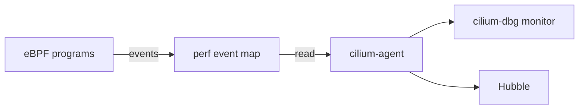

# Live Events With cilium-dbg monitor And The Loaded Programs

Static tables show the state, but a problem often depends on what happens to a particular packet. This part uses the event stream of the agent to watch decisions as they happen, shows how Hubble relates to that stream, and ends with a check of the programs that are attached to the interfaces of the node.

## The event path

The datapath programs write events to a perf event map, a kernel buffer that user space reads. Three kinds of events matter here. A drop event says that a program dropped a packet and gives a reason. A trace event says that a packet passed a point in the datapath. A policy verdict event says that a policy decided the fate of a connection. The agent reads these events and offers them in two forms: the `cilium-dbg monitor` command on one node and Hubble flows for the whole cluster.



The diagram shows that the monitor command and Hubble read the same events from the agent.

## Watch drops

Start the monitor on the agent of the node of the `probe` pod, and filter for drops. Leave it running in one terminal:

<!-- astrona:playground:renew -->

```sh
kubectl -n kube-system exec $AGENT_POD -c cilium-agent -- cilium-dbg monitor --type drop
```

In a second terminal, send a request from the client that a policy blocks, for example from `drifter`, with a short timeout:

```sh
kubectl -n outpost exec deploy/drifter -- curl -s -m 5 -o /dev/null http://probe.starfleet.svc/status/200
```

If a policy selects `probe` and does not allow `drifter`, the monitor prints a drop event. The event names the reason, for example that the policy denied the traffic, and it names the source and destination identities, the endpoint ID and the addresses. Compare these numbers with the IP cache and the policy map from the earlier reads. When no drop event appears, the packet did not reach this node or no policy blocked it.

Other useful filters are `--type trace` for all passing traffic, `--type policy-verdict` for verdicts, and `--from` and `--to` with an endpoint ID. Trace output on a busy node is large, so always add a filter.

## Hubble for the same events

Hubble shows the same events as flows and adds the Kubernetes names of the workloads. The `hubble` command needs a connection to Relay. When it has one, the equivalent of the drop watch reads like this:

```sh
hubble observe --verdict DROPPED --namespace starfleet
```

Use `cilium-dbg monitor` when you are on one node and need raw detail such as the endpoint ID. Use Hubble when you need the flows of the whole cluster with pod names.

## The programs on the node

After the events, check what is attached. The `bpftool net show` command groups programs by interface, and the agent can describe its own view:

```sh
kubectl -n kube-system exec $AGENT_POD -c cilium-agent -- bpftool net show
```

Find the interface of the `probe` pod in the output. Its name starts with `lxc`, and the endpoint JSON from the endpoint detail command gives the exact interface name. The interface has a tc ingress program. If an endpoint exists but its interface has no program, the agent has not finished building the endpoint, and the endpoint state in the list shows it.

## A checklist for a dropped request

When a pod cannot reach another pod or Service, use the same order every time:

1. Find the node and the agent of the destination pod.
2. Read the endpoint list and check the state and the policy enforcement columns.
3. Read the IP cache entry of the source address and compare the identity.
4. Read the policy map of the destination endpoint for that identity and the port.
5. Start `cilium-dbg monitor --type drop` and repeat the request with a new connection.

The first step that gives an unexpected result names the layer to fix: a pod that is not ready, a missing identity, a policy gap or a path that never reaches the node.

## What you now know

You can watch drop and trace events on a node, compare them with the tables that hold the decision data, and use Hubble for the same events across the cluster. You can check that an endpoint interface has a program attached. These steps together let you explain what the eBPF datapath did with one request.

## Common pitfalls

> [!WARNING]
> Do not run `cilium-dbg monitor` without a filter on a busy node, because the output is large and slows your terminal. A monitor session only sees the node where it runs, so a drop on another node never appears there. Do not repeat the test over a connection that was open before the policy change, because it has a connection tracking entry.
