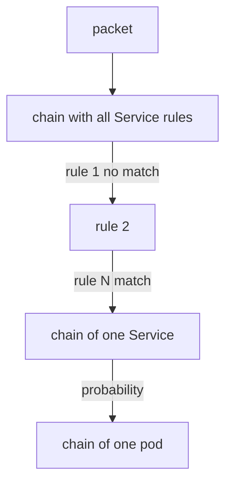
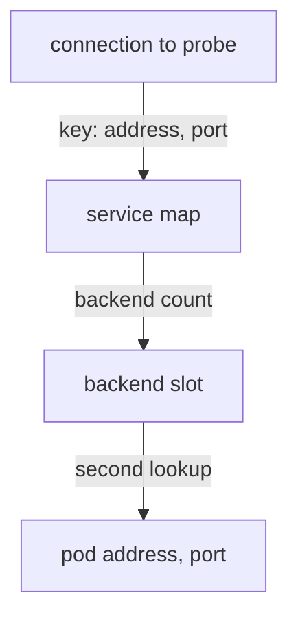

# Map Lookups And Incremental Updates Compared With Rule Chains

A Kubernetes cluster with a few hundred Services and several thousand pods must answer one question for every new connection: which pod receives it? How the datapath answers that question decides how the cost grows when the cluster grows. This part compares the two ways that Linux can answer it. One is a list of rules that the kernel reads in order. The other is a hash map that the kernel indexes with a key.

## The rule chain model

The default Kubernetes component for Services is kube-proxy. In its iptables mode, kube-proxy writes rules into the NAT table of netfilter, the packet filtering framework of the Linux kernel. A chain is an ordered list of rules. The kernel compares a packet with the rules of a chain from the first rule to the last, and it stops at the first rule that matches and has a final action.

For each Service, kube-proxy adds a rule that matches the cluster IP and port and jumps to a chain for that Service. That chain has one rule for each backend pod, and each rule picks its pod with a probability, so the traffic spreads. The entry point is one chain that holds the rules of all Services. A packet for the last Service in that chain passes the rules of every Service before it.



The diagram shows that the cost for a packet grows with the position of its Service in the first chain, and the cost for the first packet of a connection grows with the number of Services.

The part of the kernel that remembers connections, conntrack, limits this cost. Only the first packet of a connection walks the chain. Later packets of the same connection follow the stored translation. The walk still happens for every new connection, so a cluster that opens many short connections pays it many times.

## The map model

Cilium stores the same information in a hash map. A hash map computes a number from the key and uses that number to find the entry. The time to find an entry does not depend on how many entries the map holds. In the Cilium service map, the key is the Service address, the port and a slot number, and the value is the backend that holds the pod address and port.

When a connection to the cluster IP of `probe` starts, the program builds the key from the destination address and port. One lookup returns the Service entry, which says how many backends exist. The program picks a backend slot, and a second lookup returns the pod address and port. The number of Services does not change the number of lookups.



The diagram shows two lookups in a fixed number of steps. The path has the same length for a cluster with ten Services and a cluster with ten thousand Services.

## Updates reach the kernel in different ways

A cluster changes all the time. A pod starts, a Service gets a new backend, a pod is deleted. Each change must reach the datapath. Here the two models differ in the size of the write.

In the iptables model, kube-proxy keeps a copy of the wanted rules and writes them with a restore operation that loads many rules in one step. Newer versions write only the chains that changed, but the kernel still has to replace rules in chains whose size grows with the cluster, and the rule list is rebuilt in kernel memory. A large cluster with many changes spends noticeable CPU time on these writes, and a change can take effect only after the whole write finishes.

In the Cilium model, the agent receives the change from the Kubernetes API and writes only the affected entries into the maps through the `bpf()` system call. A new backend for `probe` is one new backend entry and an update of the backend count in the service entry. Other Services are not touched, and the kernel does not rebuild anything. A running program sees the new entry on its next lookup.

## What this does and does not change

A constant-time lookup does not make every network path fast. The packet still passes the kernel network stack, the network driver and the physical network. The gain is in the part that depends on the size of the cluster, which is the Service lookup and the update cost. For a small cluster with few Services, the difference is small. The benefit appears as the number of Services and endpoints grows.

Maps also have a fixed maximum size. A map that is full rejects new entries, so the constant-time property comes with a capacity limit that must be sized for the cluster. The agent sizes its maps from its configuration, and the node memory sets how large they can be.

## Try it on the playground

You will add a Service and watch the map change. Save this as `service-demo-a.yaml`:

<!-- astrona:playground:renew -->

```yaml
apiVersion: v1
kind: Service
metadata:
  name: demo-a
  namespace: starfleet
spec:
  selector:
    app: probe
  ports:
    - name: http
      port: 80
      targetPort: 8080
```

First list the current frontends. Save the agent pod name and print the service map:

```sh
AGENT=$(kubectl -n kube-system get pods -l k8s-app=cilium -o jsonpath='{.items[0].metadata.name}')
kubectl -n kube-system exec "$AGENT" -c cilium-agent -- cilium-dbg bpf lb list
```

Apply the Service:

```sh
kubectl apply -f service-demo-a.yaml
```

Read the cluster IP that Kubernetes assigned, then list the map again and look for that address with port 80 and for the pod address with port 8080 next to it:

```sh
kubectl -n starfleet get service demo-a -o jsonpath='{.spec.clusterIP}{"\n"}'
kubectl -n kube-system exec "$AGENT" -c cilium-agent -- cilium-dbg bpf lb list
```

The second listing has the new frontend and the same backends as `probe`, because both Services select the same pods. No other entry changed. Finally, test that the new Service works by sending a request from the `shuttle` pod:

```sh
kubectl -n starfleet exec deploy/shuttle -- curl -s -m 5 -o /dev/null -w '%{http_code}\n' http://demo-a.starfleet.svc/status/200
```

If the request fails right after you create the Service, wait a few seconds and send it again, because the agent needs a moment to write the entry.

## What you now know

A rule chain makes the cost of a new connection depend on the number of rules, and each update rewrites rules in the kernel. A hash map makes the lookup cost fixed, and the agent changes only the entries that belong to the change. The remaining question is how many steps a packet takes after the lookup, and where Cilium removes steps.

## Common pitfalls

> [!WARNING]
> Do not read "constant time" as "no limit". A map has a fixed maximum size, and a full map rejects new entries. Also compare the cost of the first packet of a connection, not of every packet, because connection tracking handles the later packets in both models.
