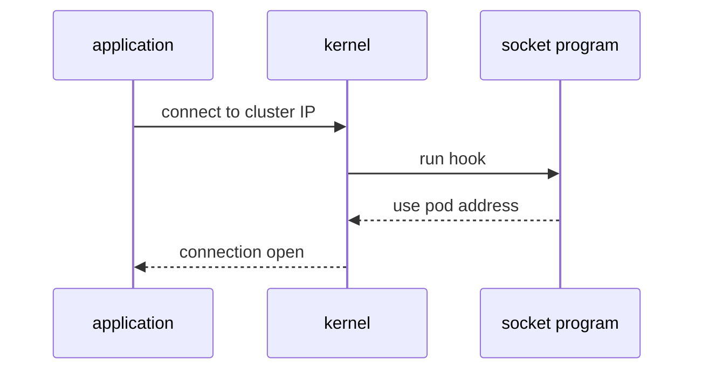

# Socket Load Balancing, Host Routing And XDP

A packet that travels from one pod to another passes many places: the network stack of the sending pod, the virtual interface, the network stack of the node, netfilter and the routing code, and then the same places on the way in. Every place costs CPU time and can change the packet. This part explains three features that remove steps from this path and states what each one changes.

## Translation at the socket

Take the request from the `shuttle` pod to the cluster IP of `probe`. A cluster IP does not belong to any interface. Something must replace it with the address of a pod, and that replacement is called destination NAT (network address translation). In the netfilter model, the node does the replacement on each packet of the connection and stores the result in conntrack. It must also translate the reply packets back, so the client sees answers from the cluster IP.

Cilium can do the replacement before the connection exists. The application calls `connect()` with the cluster IP. A cgroup socket address hook runs an eBPF program at that moment. The program looks up the service map, picks a backend and changes the destination address in the system call. The kernel then opens the connection directly to the pod address. The application does not see the change: when it asks for the peer address with the `getpeername()` system call, the program returns the cluster IP again.



The diagram shows that the translation happens once, when the connection opens, and not for every packet.

The result is that packets of this connection carry the pod address from the first packet. No destination NAT and no reply translation are needed for them. This is the reason that a request from a pod to a Service is cheap in Cilium. The feature applies to traffic that starts at a socket on the node, which covers pods connecting to a Service. Traffic from outside the cluster has no local socket to hook, so that traffic is translated on the packet path by a tc program.

## eBPF host routing

A packet that leaves a pod arrives on the node end of the virtual interface. In the default path, the kernel passes it up into the network stack of the node, where routing and netfilter run, and then back down to the interface towards the destination. For a pod on the same node, that is a detour through the host stack.

With eBPF host routing, the tc program on the virtual interface decides the next hop and redirects the packet to the destination interface directly, with a helper function that moves the packet to another interface. The packet skips the upper host stack and the netfilter hooks. The feature needs a recent enough kernel and a setup in which Cilium handles the routing and the Service translation, so Cilium checks the node at start and falls back to the legacy path when the node cannot support it. Because of the fallback, two clusters with different kernels can run different paths with the same Cilium version.

## XDP

The tc hook runs after the kernel has allocated its packet structure for the frame. XDP (eXpress Data Path) runs earlier, in the network driver, before that allocation. A program at this hook can drop a frame, send it back out of the same interface or pass it up to the kernel. Cilium can use XDP to accelerate the load balancing of traffic that arrives from outside the cluster, for example connections to a NodePort Service, on drivers that support it.

XDP is optional and depends on the network driver. It is not the default path for pod-to-pod traffic, and it does not replace the tc programs that enforce policy on pod interfaces. It applies at the edge of the node, where the saving of an early decision is the largest.

## Which path does a request take

For a request from `shuttle` to `probe`, the likely path with all features active is short: the socket program replaces the cluster IP with the pod address at `connect()`, the tc program on the virtual interface enforces policy and redirects the packet, and the destination pod receives it. With none of the features active, the same request takes the netfilter path with destination NAT and the host stack. You cannot tell which path your cluster uses from the YAML. You must ask the agent.

## A worked comparison

Count the steps for one request from `shuttle` to `probe` when the `probe` pod runs on the other node. In the netfilter model, the first packet leaves the pod and reaches the node. The NAT table matches the cluster IP and replaces it with a pod address, and conntrack stores the translation. The routing code sends the packet to the other node. There, the packet passes the node stack again before it reaches the pod. Each reply packet passes conntrack on the way back, which restores the cluster IP.

With socket load balancing, the first packet already carries the pod address, so the NAT step and the reverse translation do not exist for this connection. With eBPF host routing, the packet also skips the host stack on the sending node. The packet still crosses the physical network and still passes the policy check at the destination pod. The work that remains is the work that cannot be removed: policy and delivery.

## Where the shorter path can fail

A shorter path has its own failure cases. If the socket program does not run for a process, for example because the process lives in a different cgroup hierarchy than the one the program is attached to, the connection is not translated at `connect()`. The cluster IP then reaches the network, where no interface owns it, and the connection fails or relies on a second translation step on the packet path. This is why Cilium keeps the tc-level Service translation as well.

If a node falls back from eBPF host routing to the legacy path, traffic still works, but it passes the host stack and netfilter again. Connections do not break. The only visible change is a higher cost per packet. To find such a difference between nodes, compare the agent status of each node and not only one agent.

## Try it on the playground

Ask the agent which datapath features it enabled. The first command prints the summary, and the second one prints more detail:

<!-- astrona:playground:renew -->

```sh
kubectl -n kube-system exec ds/cilium -c cilium-agent -- cilium-dbg status
kubectl -n kube-system exec ds/cilium -c cilium-agent -- cilium-dbg status --verbose
```

Find the line that starts with `KubeProxyReplacement`. Then look in the detailed output for entries that mention the socket load balancer and for a line about host routing. The values depend on the kernel of your machine and on the Helm values of the playground, so read what your agent reports and do not assume a value.

Next, check which Service address a client sees. The `connect()` hook rewrites the address inside the kernel, so the application still sees the cluster IP. Read the cluster IP and the pod addresses, then print the map entries that connect them:

```sh
kubectl -n starfleet get service probe -o jsonpath='{.spec.clusterIP}{"\n"}'
kubectl -n starfleet get pods -l app=probe -o wide
kubectl -n kube-system exec ds/cilium -c cilium-agent -- cilium-dbg bpf lb list
```

Finally, send a request from the `shuttle` pod and confirm that the Service still works:

```sh
kubectl -n starfleet exec deploy/shuttle -- curl -s -m 5 -o /dev/null -w '%{http_code}\n' http://probe.starfleet.svc/status/200
```

## What you now know

Socket load balancing moves the Service translation from every packet to one step at `connect()`. eBPF host routing lets a program redirect a packet to its destination interface without the host stack. XDP gives an early decision in the network driver for traffic that enters the node. Each feature depends on the kernel and the configuration, so the agent status is the source of truth. The remaining question is what an operator can see and change while the datapath runs.

## Common pitfalls

> [!WARNING]
> Do not assume that all three features are active on your cluster. They depend on the kernel, the driver and the Helm values, and Cilium falls back to older behavior when a node cannot support a feature. Read `cilium-dbg status` on the node you care about. Do not read the benefit of a feature as a benchmark result: the gain depends on the workload.
