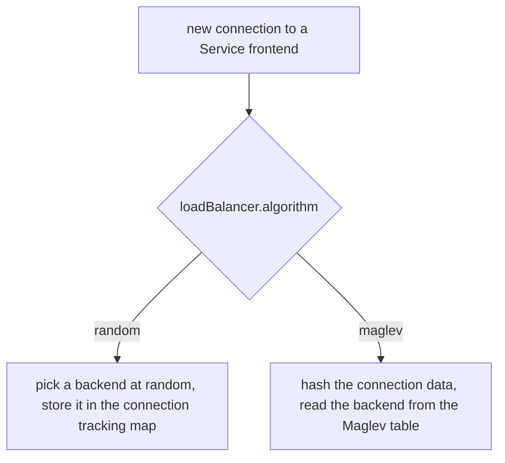

# Backend Selection, Maglev And Direct Server Return

Moving Service translation into eBPF maps removes the rule chains, but a Service with several backends still needs a decision: which backend gets this connection? Cilium also has to decide what happens to the reply packets, because the path of the reply changes how much work each node does. This part explains the backend selection algorithms and the load balancing modes, and it shows where to read the active setting on a running agent.

## How a backend is selected

A Service frontend in the service map points to a list of backends. When a new connection arrives, the datapath must pick one entry from that list. Cilium supports two algorithms.

The default algorithm is `random`. The program picks a backend with a pseudo random number for each new connection and stores the choice in the connection tracking map, so all packets of one connection reach the same backend. The cost is small, and the spread over many connections is even.

The second algorithm is Maglev, a consistent hashing algorithm. Maglev builds a lookup table for each Service from the list of backends. It then uses a hash of the connection data to find a backend in the table. The result has two properties that matter for traffic that arrives from outside the cluster. First, two nodes that receive packets of the same connection pick the same backend, even though they share no state. Second, when a backend is added or removed, only a small share of the table entries change, so most existing flows keep their backend.

You select the algorithm with the Helm value `loadBalancer.algorithm`. The value is `random` or `maglev`. The Maglev table has a fixed size, which is a prime number set with `maglev.tableSize`. A larger table spreads traffic more evenly and uses more memory in the maps. Changing the algorithm is a configuration change that restarts the agents, so plan it like any other Cilium upgrade.



The diagram shows that both algorithms start from the same frontend and differ only in how they choose the backend.

## What happens to the reply

For a NodePort or LoadBalancer Service, an external client sends its request to one node. That node translates the destination to a pod, and the pod may run on another node. The next question is which way the reply travels.

In `snat` mode, which is the default, the first node also replaces the source address of the forwarded packet with its own address. The backend node then sends the reply back to the first node, and the first node translates it back and returns it to the client. Every reply crosses the first node. This mode works on every network, but it adds one hop and it hides the real client address from the pod, unless the Service uses `externalTrafficPolicy: Local`.

In `dsr` mode (direct server return), the first node forwards the packet to the backend node and keeps the client address as the source. The backend node answers the client directly, with the Service address as the source of the reply. The reply never returns to the first node. This shortens the reply path, keeps the client address visible in the pod and reduces the load on the first node. The reply path is often much larger than the request, for example for a file download, so the saving can be large.

The third value, `hybrid`, uses DSR for TCP and SNAT for UDP. You set the mode with `loadBalancer.mode`. DSR needs the backend node to accept the packet with the Service address, so it has requirements on the network and on the routing mode of Cilium. The requirements differ between releases. Read the kube-proxy replacement page of your release before you enable it.

## Read the active settings

The agent reports the active settings. Run the status command with `--verbose` and look at the section about kube-proxy replacement, which prints the mode and the backend selection algorithm:

<!-- astrona:playground:renew -->

```sh
kubectl -n kube-system exec ds/cilium -c cilium-agent -- cilium-dbg status --verbose
```

Find the lines that name the mode and the backend selection. On a default installation they show SNAT and the random algorithm. The Helm values behind them are readable in the release:

```sh
helm -n kube-system get values cilium --all | grep -A2 -i "loadBalancer"
```

The output lists `loadBalancer` settings with their values, including `algorithm` and `mode`. Compare them with the agent output. If they differ, an upgrade has not finished or the agents have not restarted.

## Compare the entries in the service map

The algorithm changes how a backend is chosen, and it does not change the frontend entries that you read earlier. Print the service map once more and note that each frontend still has its backend list:

```sh
kubectl -n kube-system exec ds/cilium -c cilium-agent -- cilium-dbg bpf lb list
```

With Maglev, the agent additionally keeps a Maglev table for each Service. Those tables exist in a separate map, and you can list the maps with `cilium-dbg map list` to see whether a Maglev map is present on your cluster.

## What you now know

The datapath selects a backend once per connection, either at random or with the Maglev table, and then remembers the choice. The load balancing mode decides whether the reply returns through the first node (`snat`) or goes directly from the backend node to the client (`dsr`). Both settings are Helm values, and the agent reports what is active. The open question is what other kernel features Cilium uses to improve throughput and how to judge whether they help your cluster.

## Common pitfalls

> [!WARNING]
> Do not enable DSR without reading the requirements of your release: a network that drops packets with an unexpected source address breaks replies silently. Do not assume Maglev is faster than the default; it gives stable backend choice across nodes, and that matters mainly for external traffic. Changing either setting restarts the agents, so test it on one cluster first.
