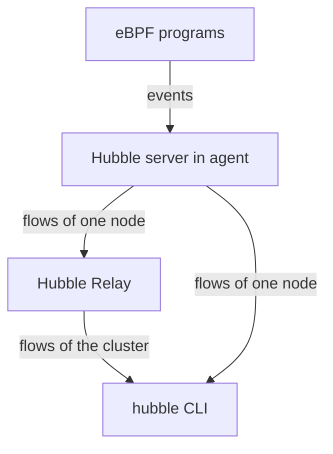

# Observability With Hubble

When a request fails in a cluster, the first question is where it stopped. With iptables, the answer often needs packet captures or log rules on the node. Cilium already has a program on the path of every packet, and that program knows the identity of both sides and the policy verdict. Hubble is the part of Cilium that turns this knowledge into events you can read. This part explains how Hubble works, how to enable it and how to read what it shows.

## Where the events come from

The eBPF programs of Cilium emit an event when something noteworthy happens to a packet: it is forwarded, it is dropped by policy, it is translated or it is traced at a point on its path. The program writes the event into a perf event map or a ring buffer, which are map types that carry data from the kernel to user space. The Cilium agent reads that buffer.

Hubble is the observability layer inside the agent. Its server turns the raw events into flows. A flow is a record of one network event. It holds the source and destination, with pod names, namespaces and labels that the agent adds from its endpoint data. It also holds the protocol and port, the verdict and, for a drop, the drop reason. The agent keeps the most recent flows in a fixed-size ring in memory, so old flows disappear.

Because the program already runs on the packet path, collecting the event costs little. No sidecar proxy is needed and the application does not change.

## The components

Hubble has several parts, and each does one job.

- The Hubble server runs inside each Cilium agent. It serves the flows of its own node over gRPC, a remote procedure call protocol.
- Hubble Relay is a Deployment in `kube-system`. It connects to the Hubble server of every agent and offers one endpoint with the flows of the whole cluster.
- The `hubble` command line client reads flows from a server or from Relay. The Cilium agent image contains the client, so `hubble observe` runs inside an agent pod and reads the flows of that node.
- Hubble UI is an optional web page that draws a map of the services. It is not needed for the tasks here.



The diagram shows that the CLI can read one node directly from the agent or the whole cluster through Relay.

## Enabling Hubble on a running cluster

Hubble is a setting of the Cilium Helm chart. Cilium reads it when the agents start, so the change needs a Helm upgrade and rolls the agents. Use `--reuse-values` so the other settings of the release stay unchanged. The values that matter are `hubble.enabled` for the server in the agents and `hubble.relay.enabled` for Relay.

Because the agents restart, pods on the node keep their existing connections, but new policy and Service changes wait until the agent is back. Plan an upgrade at a time when no change is rolling out.

## Reading a flow

A line from `hubble observe` shows the time, the source, an arrow, the destination, the type of event, the verdict and a summary. The verdict is the part you need most often. FORWARDED means the datapath let the packet through. DROPPED means it did not, and the line names the reason. A drop caused by network policy has the reason Policy denied. Other reasons exist, for example a packet with an invalid header, so read the reason and do not assume policy.

Filters narrow the output. `--namespace` selects a namespace, `--verdict` selects a verdict, `--last` limits the number of flows and `--follow` keeps the stream open. A flow for a Service request shows the pod that the program selected as the destination, so one flow also tells you which backend served the connection.

## Try it on the playground

Hubble is off. First check that no Hubble Relay Service exists:

<!-- astrona:playground:renew -->

```sh
kubectl -n kube-system get services
```

Add the chart repository and upgrade the release. The version is the one the playground installed:

```sh
helm repo add cilium https://helm.cilium.io/
helm repo update
helm upgrade cilium cilium/cilium --version 1.20.2 --namespace kube-system --reuse-values \
  --set hubble.enabled=true --set hubble.relay.enabled=true --wait --timeout 300s
```

Wait until the agents and Relay are ready:

```sh
kubectl -n kube-system rollout status daemonset/cilium --timeout=300s
kubectl -n kube-system rollout status deployment/hubble-relay --timeout=300s
```

To see a drop, a policy must select the `probe` pods. Save this as `ciliumnetworkpolicy-probe.yaml`:

```yaml
apiVersion: cilium.io/v2
kind: CiliumNetworkPolicy
metadata:
  name: probe-from-shuttle
  namespace: starfleet
spec:
  endpointSelector:
    matchLabels:
      app: probe
  ingress:
    - fromEndpoints:
        - matchLabels:
            app: shuttle
      toPorts:
        - ports:
            - port: "8080"
              protocol: TCP
```

Apply it and send one request from each client:

```sh
kubectl apply -f ciliumnetworkpolicy-probe.yaml
kubectl -n starfleet exec deploy/shuttle -- curl -s -m 5 -o /dev/null -w '%{http_code}\n' http://probe.starfleet.svc/status/200
kubectl -n outpost exec deploy/drifter -- curl -s -m 5 -o /dev/null -w '%{http_code}\n' http://probe.starfleet.svc/status/200
```

The request from `drifter` stops after five seconds because the policy drops it. Now read the flows. Hubble shows a node's flows on that node, so list the agents with their nodes and find the node of the `probe` pod:

```sh
kubectl -n starfleet get pods -l app=probe -o wide
kubectl -n kube-system get pods -l k8s-app=cilium -o wide
```

Replace `<AGENT>` with the agent pod on the same node as the `probe` pod:

```sh
kubectl -n kube-system exec <AGENT> -c cilium-agent -- hubble observe --namespace starfleet --last 30
```

Find one line with the verdict FORWARDED from the `shuttle` pod and one with DROPPED from the `drifter` pod. Narrow the output to drops only:

```sh
kubectl -n kube-system exec <AGENT> -c cilium-agent -- hubble observe --namespace starfleet --verdict DROPPED --last 10
```

## What you now know

The programs of the datapath emit events, the agent turns them into flows with names and labels, and Hubble Relay combines the flows of all nodes. A flow carries a verdict and, for a drop, a reason, so you can tell a policy drop from another drop without a packet capture. The remaining question is how safe it is to run and change this datapath on a production node.

## Common pitfalls

> [!WARNING]
> `hubble observe` inside an agent shows only the flows of that node, and the agent keeps only a limited number of recent flows. A missing flow can mean that you asked the wrong node or that the ring has already overwritten it. Enabling Hubble restarts the agents, so do not do it while another change is rolling out.
