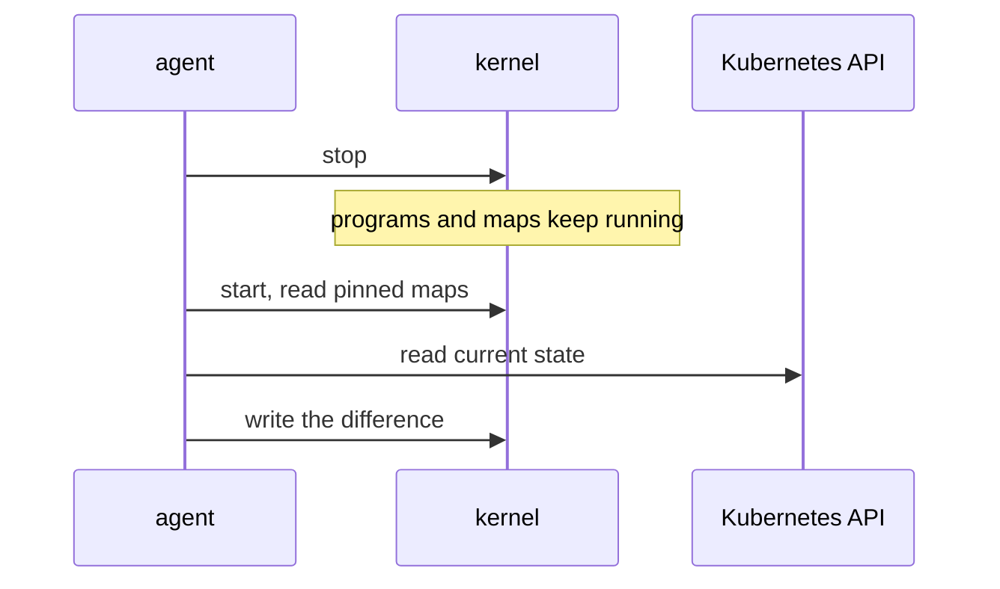

# Safety, Live Updates And Agent Restarts

A network datapath runs on every node of a production cluster, and a fault in it affects every pod on the node. Operators therefore care about three questions. Can a faulty program crash the node? Can the datapath change without dropping connections? What happens to traffic when the management process stops? This part answers each question from the way eBPF and the Cilium agent work.

## Why a bad program cannot crash the node

The kernel checks every program before it runs and rejects a program that could read invalid memory or never end. A program that fails the check never starts. A kernel module has no such check: it runs with full kernel privileges, and a pointer error in it can halt the machine.

This gives Cilium a safety property that older approaches did not have, but it has limits. The verifier proves safety and not correctness, so a program that drops all traffic is accepted. A wrong policy still breaks traffic, and the cause is a configuration error, not a crash. The Cilium project also tests that its programs pass the verifier on the kernel versions it supports. On an unsupported or unusual kernel, the load can fail, and then the agent reports an error instead of running a broken datapath.

Cilium needs no kernel module and no reboot. The kernel already contains the eBPF subsystem, so installing or upgrading Cilium loads programs into a running kernel.

## Replacing a program while traffic flows

A new Cilium version or a changed setting needs new program code on the pod interfaces. The kernel can attach a new program to a hook and replace the old one in one step. Packets that arrive before the replacement run the old program, and later packets run the new one. No packet sees a hook without a program. Changes to policy and Services are even smaller, because they only change map entries, and no program is replaced.

Map entries change in a single `bpf()` call for each entry. A running program reads either the old entry or the new entry, never a half-written one for a single key. When a change involves several entries, for example a Service with several backends, a short window can exist in which some entries are new and some are old. The agent writes the entries in an order that keeps the Service usable during the window.

## What happens when the agent stops

The agent is a user space process, and the programs and maps are objects in the kernel. A program stays attached for as long as the kernel holds a reference to it, and Cilium pins its maps in the BPF file system, the file system at `/sys/fs/bpf` that keeps map objects alive without a running process. When the agent pod stops, the programs keep running with the map contents they had.

So during an agent restart, connections keep flowing, and policy and Service state stay as they were. What stops is change. A new pod that starts during the restart has no endpoint until the agent returns. A new Service or a policy change is not applied until the agent returns. When the agent starts again, it reads the pinned maps, compares them with the Kubernetes API and writes the difference.



The diagram shows that the kernel keeps forwarding while the agent is down, and that the agent catches up after it starts.

## What can still go wrong

The datapath survives a restart, but it does not survive everything. If the agent stays down for long, the maps drift from the cluster: a backend that no longer exists remains in the Service map, and a program forwards connections to a pod that is gone. A node that reboots loses its programs and maps, because the BPF file system lives in memory, so the node has no datapath until the agent starts again. Also, an upgrade between versions can change the layout of a map, and the agent must handle that during start. Treat agent upgrades as a rolling change, one node at a time.

## Try it on the playground

You will restart the agents while a client keeps sending requests. First, look at what the agent pinned. The directory is on the node and survives the restart of the pod:

<!-- astrona:playground:renew -->

```sh
kubectl -n kube-system exec ds/cilium -c cilium-agent -- ls /sys/fs/bpf
```

Start a loop that sends one request per second from the `shuttle` pod and prints the HTTP status code. Run it in a second terminal and leave it running:

```sh
kubectl -n starfleet exec deploy/shuttle -- sh -c 'while true; do curl -s -m 2 -o /dev/null -w "%{http_code}\n" http://probe.starfleet.svc/status/200; sleep 1; done'
```

In the first terminal, restart the agents and wait until they are ready:

```sh
kubectl -n kube-system rollout restart daemonset/cilium
kubectl -n kube-system rollout status daemonset/cilium --timeout=300s
```

Watch the loop while the agents restart. The datapath design predicts that established forwarding continues, but you should read your own result and not assume it. Count any line that is not the status code 200. When the rollout is done, stop the loop with Ctrl+C and list the pinned maps again:

```sh
kubectl -n kube-system exec ds/cilium -c cilium-agent -- ls /sys/fs/bpf
```

The pinned entries are still there, because the file system belongs to the node and not to the pod. Finally, confirm that the agent is healthy again:

```sh
kubectl -n kube-system exec ds/cilium -c cilium-agent -- cilium-dbg status --brief
```

## What you now know

The verifier keeps a faulty program from running, and no kernel module or reboot is involved. A new program replaces an old one in a single step, and policy and Service changes are map writes. The kernel holds the programs and the pinned maps, so traffic keeps flowing when the agent restarts, while changes wait until the agent is back. The limit of this design is long agent outages and node reboots, which leave the maps stale or empty.

## Common pitfalls

> [!WARNING]
> Do not claim that a restart can never affect traffic. Established forwarding continues, but a pod that starts during the restart waits for its endpoint, and a policy or Service change waits until the agent returns. Also, a node reboot clears the BPF file system, so no datapath exists on that node until the agent starts. Restart agents one node at a time in production.
