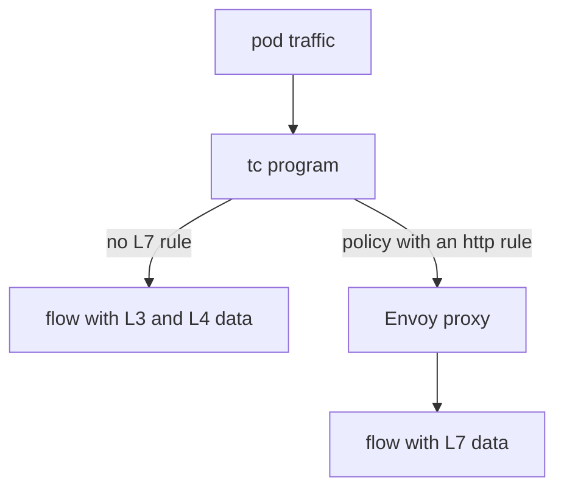

# Hubble Metrics, The Hubble UI And Layer 7 Visibility

Reading single flows answers the question about one request. Operators also need totals over time, such as how many packets the policy dropped in the last hour, and a picture of which workloads talk to each other. Hubble provides both, and it can show Layer 7 data such as HTTP methods and paths when Cilium has a reason to parse them. This part covers metrics, the UI and the conditions for Layer 7 visibility.

## Hubble metrics

The Hubble server in each agent can count the flows that it sees and publish the counters in the Prometheus format. Prometheus is a monitoring system that collects counters from an HTTP endpoint on a schedule. You choose the metric groups with the Helm value `hubble.metrics.enabled`. It takes a list of names, for example `dns`, `drop`, `tcp`, `flow`, `port-distribution`, `icmp` and `httpV2`.

Each group produces a family of counters:

- `drop` counts dropped packets by reason and protocol.
- `flow` counts all processed flows by type and verdict.
- `tcp` counts TCP flags, such as SYN and FIN.
- `dns` counts DNS queries and responses.
- `httpV2` counts HTTP requests and their status codes, and it needs Layer 7 data.

The agent serves the metrics on its own port, which is 9965 for Hubble. Enabling a group restarts the agents. Metric groups add CPU and memory cost and create a label set for each combination of values, so enable only the groups you use.

You can enable metrics on a running release with the same pattern that you used for Hubble itself:

```sh
helm upgrade cilium cilium/cilium --version 1.20.2 --namespace kube-system --reuse-values \
  --set hubble.enabled=true --set hubble.relay.enabled=true \
  --set hubble.metrics.enabled="{drop,flow,tcp}"
```

The braces make the value a list. The release then exposes a metrics Service for the agents.

## Read a metric without Prometheus

Prometheus is not required to see the counters. The endpoint is plain text over HTTP. Open a shell on an agent pod and request it, or port-forward to it:

<!-- astrona:playground:renew -->

```sh
kubectl -n kube-system exec ds/cilium -c cilium-agent -- curl -s localhost:9965/metrics
```

Look for lines that start with `hubble_drop_total` and `hubble_flows_processed_total`. Each line has labels such as the protocol, the verdict and the reason, followed by a number. Send a request from `drifter` to `probe`, run the command again and compare the drop counter. If the example policy from the lab drops the request, the counter for the reason `POLICY_DENIED` grows. A counter never decreases while the agent runs, so compare two readings.

## The Hubble UI

The Hubble UI is a web page that draws a service map: it shows which workloads in a namespace sent flows to which others, and whether the verdict was forwarded or dropped. It reads from Hubble Relay. You enable it with `hubble.ui.enabled=true`, and it runs as a Deployment named `hubble-ui` in `kube-system`. Reach it without an ingress with a port-forward:

```sh
kubectl -n kube-system port-forward service/hubble-ui 12000:80
```

Then open `http://localhost:12000` in a browser and select the `starfleet` namespace. The Cilium CLI offers a shorter form, `cilium hubble ui`, which opens the port-forward for you. The map is built from the flows that Relay holds, so generate some traffic first.

## When flows show Layer 7 data

The tc programs see packets, so they report Layer 3 and Layer 4 facts: addresses, ports and TCP flags. They cannot read an HTTP method from a stream that arrives in many packets. For Layer 7, Cilium redirects the traffic of selected endpoints to an Envoy proxy that runs next to the agent. Envoy parses the protocol and reports the request to Hubble.

Cilium makes this redirect only when a policy asks for it. A rule in a `CiliumNetworkPolicy` with an `http` section, for example a method and a path, sends the matching traffic through Envoy. After that, `hubble observe` shows HTTP flows with the method, the URL and the status code, and the `httpV2` metrics have data. Without such a rule, flows stay at Layer 4, even when the application speaks HTTP.



The diagram shows that the L7 data exists only on the path through Envoy, which a policy rule selects.

## What you now know

Hubble metrics turn flows into counters that Prometheus collects, the Hubble UI draws the service map from Relay, and Layer 7 detail appears only for traffic that a policy sends through Envoy. The remaining question is how eBPF improves security itself, and not only the view of it.

## Common pitfalls

> [!WARNING]
> Do not enable every metric group on a large cluster, because each group costs CPU and memory. Do not expect HTTP details in flows without an L7 rule. A Layer 7 rule also adds Envoy to the path of that traffic, so it adds latency and a place that can fail.
