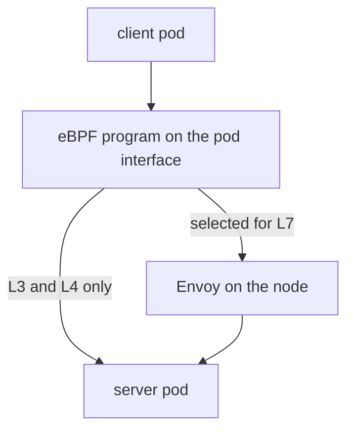

# Service Mesh Features Without Sidecar Proxies

A service mesh adds features to the traffic between applications: Layer 7 routing, retries, observability and identity-based authentication. The common way to build one places a proxy container next to every application container. Cilium offers many of these features with eBPF and one Envoy proxy for each node. This part explains how that works and what it changes.

## The sidecar model and its cost

In the sidecar model each pod has a second container with an Envoy proxy. Rules redirect all traffic of the pod through the proxy. The cost is clear: every pod uses more memory and CPU, the proxy must start before the application, and every request crosses two extra network stacks, one on each side of the connection.

## Envoy on each node

Cilium runs one Envoy proxy on each node. Since Cilium 1.16 it runs as its own DaemonSet named `cilium-envoy`, and in earlier releases it ran inside the agent. The eBPF programs decide which traffic needs Layer 7 handling and redirect only that traffic to the proxy. Traffic that needs only Layer 3 and Layer 4 rules never leaves the eBPF path.

Three features use this proxy:

- Layer 7 network policy. A rule in a `CiliumNetworkPolicy` can name an HTTP method and path, a gRPC service or a DNS name pattern. The proxy checks the request and returns an error to the client for a request that the rule does not allow.
- Ingress. With `ingressController.enabled=true` Cilium acts as a Kubernetes Ingress controller and sends external traffic through Envoy.
- Gateway API. With `gatewayAPI.enabled=true` Cilium implements the Gateway API resources, such as `Gateway` and `HTTPRoute`. The Gateway API CRDs must be installed in the cluster first.



The diagram shows that the eBPF program sends only selected traffic through Envoy and forwards the rest directly.

## Identity and mutual authentication

Cilium also has a feature for mutual authentication, where two workloads prove their identity to each other before traffic is allowed. A policy rule asks for it with an `authentication` field. The agents use SPIFFE (Secure Production Identity Framework for Everyone) identities, which come from a SPIRE server. The feature is separate from transparent encryption and has its own status in each release, so read the documentation of your release before you plan to rely on it.

## Check which features are on

You can see the settings of the running release in the agent configuration and in the pods:

<!-- astrona:playground:renew -->

```sh
kubectl -n kube-system get configmap cilium-config -o yaml | grep -i -E "envoy|ingress|gateway"
kubectl -n kube-system get pods
```

The first command prints the Envoy-related keys. The second shows whether a `cilium-envoy` pod runs on each node. On the default playground installation, Ingress and Gateway API are off, and the keys say so.

## What you now know

Cilium adds Layer 7 policy, Ingress and Gateway API through an Envoy proxy on each node, and eBPF steers only the traffic that needs it. This removes the per-pod proxy for most cases and keeps Layer 3 and Layer 4 enforcement in the kernel. The last part looks beyond Cilium at other tools that use eBPF.

## Common pitfalls

> [!WARNING]
> Layer 7 features are not free: traffic through Envoy is slower than traffic that stays in eBPF. Gateway API needs its CRDs installed before you enable the feature. A per-node proxy is shared by the pods of the node, so plan its CPU and memory limits for the whole node.
