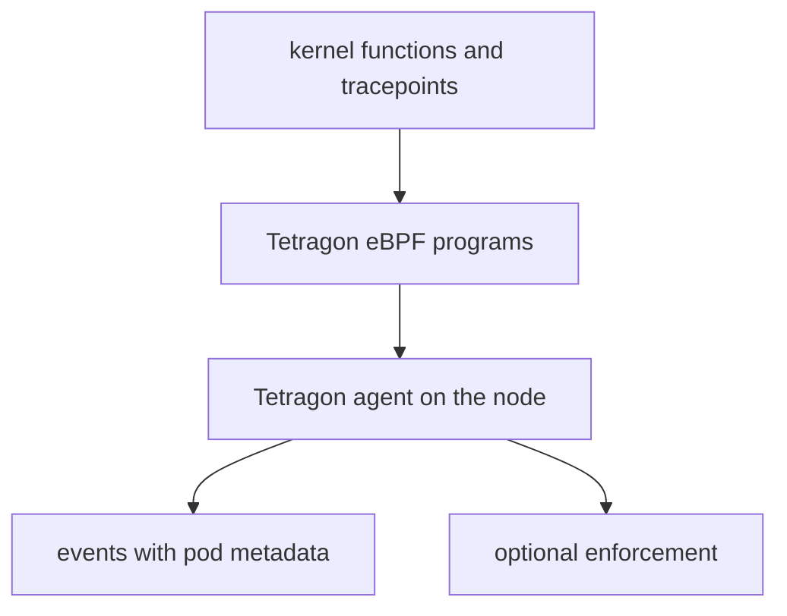

# Tetragon And The eBPF Ecosystem

Cilium uses eBPF for networking, but the same kernel mechanism supports other jobs: watching processes, files and system calls, profiling and tracing. Knowing what else exists helps you place Cilium correctly and answer questions about the role of eBPF in a larger platform. This part describes Tetragon and a short list of other eBPF projects.

## Tetragon

Tetragon is an open source project of the Cilium community for security observability and runtime enforcement. It is installed separately from Cilium, with its own Helm chart, and it runs as a DaemonSet with one pod on each node. Cilium works at the network layer. Tetragon works inside the node and watches what processes do.

Tetragon attaches eBPF programs to kernel functions and to tracepoints, which are fixed trace points in the kernel code. It can report:

- process execution, including the binary, the arguments and the pod and container that ran it;
- file access, for example a read of a sensitive file;
- network activity of a process, such as a `connect` call;
- privilege changes and use of capabilities.

You describe what to observe in a custom resource named `TracingPolicy`. A policy can also enforce: it can stop a matching process with a signal or override the return value of a call, so the call fails. Because the programs run in the kernel, a process cannot hide from them by running inside a container. Events carry Kubernetes metadata, so a log line names the pod and namespace. The `tetra` command line client prints the events with `tetra getevents`.



The diagram shows that Tetragon uses kernel hooks to produce events with Kubernetes context, and that enforcement is optional.

## Cilium and Tetragon compared

| | Cilium | Tetragon |
| --- | --- | --- |
| Main job | Networking, policy, load balancing, observability of traffic | Runtime security observability and enforcement |
| Where it hooks | tc, XDP and socket hooks | Kernel functions, tracepoints and system calls |
| What it sees | Packets and connections | Processes, files, system calls |
| Configured with | `CiliumNetworkPolicy` and Helm values | `TracingPolicy` |

They complement each other. Cilium answers which workloads may talk to each other, and Tetragon answers what a process did on the node.

## Other projects that use eBPF

- Falco is a runtime threat detection tool that can use an eBPF probe to read system call events.
- Pixie is an observability tool that uses eBPF to capture application traces without code changes.
- Katran is a Layer 4 load balancer from Meta that uses XDP.
- `bpftrace` and the BCC tools are command line tools for tracing a node with eBPF, which administrators use to debug performance problems.
- The Linux kernel itself uses eBPF for packet filtering (`seccomp` can use classic BPF, and tools such as `tcpdump` compile filters to BPF), for tracing and for scheduling work in newer releases.

The common point is the one that the earlier chapters showed: a verified program in the kernel with maps for state and a user space process that manages it.

## Look at the node from the agent

You do not need a second tool to see that Cilium is one of many users of the same mechanism. List the programs that are loaded on a node from inside a node container of the playground. Replace the node name with one from `kubectl get nodes`:

<!-- astrona:playground:renew -->

```sh
docker exec <NODE> bpftool prog show
```

Each entry has an ID, a type and a name. Programs with types such as `sched_cls` belong to tc hooks, and `cgroup_sock_addr` belongs to the socket hooks. `kind` nodes are containers on your machine, so the programs you see are loaded in the kernel of the host, and other tools on the host may appear in the list too.

## What you now know

Tetragon applies the same kernel mechanism to processes and files, and it complements the network view of Cilium. Falco, Pixie, Katran and the tracing tools use eBPF for detection, tracing and load balancing. The benefits you studied in this section, safe loading, fast maps and no kernel modules, apply to all of them.

## Common pitfalls

> [!WARNING]
> Tetragon enforcement can kill a process, so test a `TracingPolicy` in observe-only mode before you add an enforcement action. Do not confuse the tools: a `CiliumNetworkPolicy` does not restrict file access, and a `TracingPolicy` does not replace network policy. `bpftool` needs root rights on the node.
