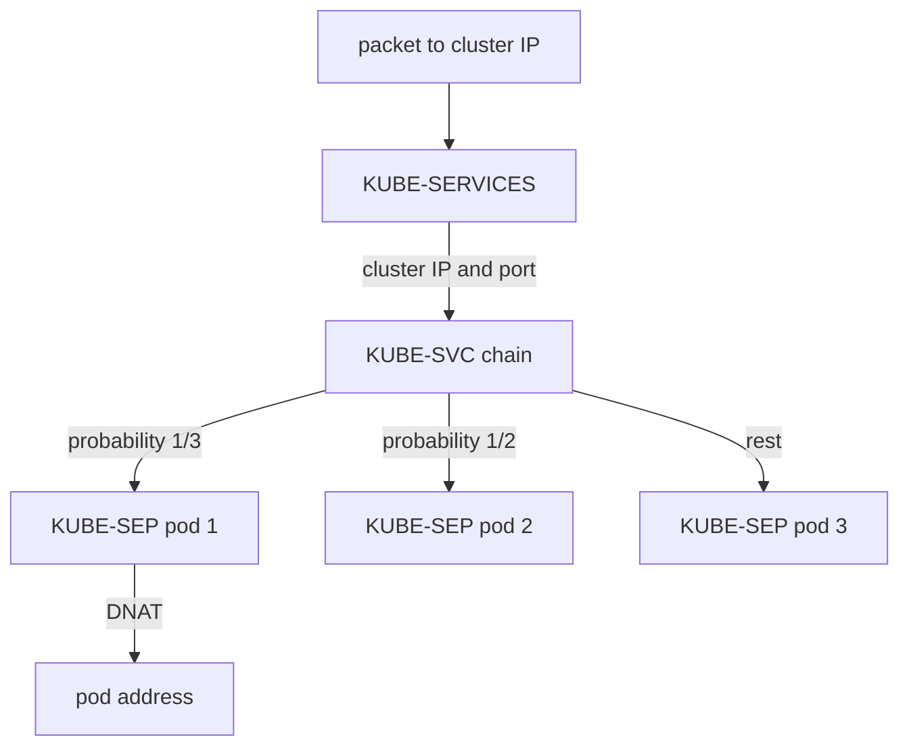

# Netfilter Hooks And The kube-proxy Chains

A Service has a cluster IP, but no network interface in the cluster owns that address. A client that sends a packet to it needs something that replaces the cluster IP with the address of one pod. In a cluster with kube-proxy in iptables mode, the Linux kernel does this with rules that kube-proxy writes. This part shows where those rules sit in the kernel, which chains exist for one Service and how a connection to the `probe` Service passes through them.

## Netfilter, tables and chains

Netfilter is the packet filtering framework of the Linux kernel. It defines hooks, which are fixed points on the path of a packet where the kernel calls registered rules. The main hooks are PREROUTING for packets that arrive, INPUT for packets for a local process, FORWARD for packets that the node passes on, OUTPUT for packets that a local process sends and POSTROUTING for packets that leave.

iptables is the user space tool that edits the rules. Rules are grouped in tables by purpose. The `nat` table holds the rules that change addresses, and it is the table that kube-proxy uses for Services. A chain is an ordered list of rules in a table. Built-in chains are attached to the hooks, and a rule can jump to a user-defined chain, which the kernel then reads from its first rule.

A pod that connects to a Service creates packets that start in the pod and pass the PREROUTING hook on the node. A process on the node that connects to a Service passes the OUTPUT hook. kube-proxy therefore adds the same jump into its chains at both hooks.

## The chains for one Service

kube-proxy watches Services and EndpointSlices through the Kubernetes API. It writes three kinds of chains for them.

- `KUBE-SERVICES` is the entry chain. It has one rule for each Service port. The rule matches the cluster IP, the protocol and the port, and it jumps to the chain of that Service. Each rule has a comment with the namespace, the Service name and the port name, such as `starfleet/probe:http cluster IP`.
- `KUBE-SVC-` followed by a hash is the chain of one Service port. It has one rule for each backend, and each rule jumps to the chain of that backend.
- `KUBE-SEP-` followed by a hash is the chain of one backend, called an endpoint. It has a rule that changes the destination to the address and port of the pod. A second rule marks traffic that comes from the pod to itself so the node can translate the source address later.

The rules in the `KUBE-SVC-` chain choose the backend at random. Each rule except the last carries a match on a probability. For three backends, the first rule matches with a probability of one third. If it does not match, the second rule matches with a probability of one half, and the last rule matches everything that is left. Each backend receives about one third of the new connections.



The diagram shows one Service with three backends. The only element that depends on the Service is the cluster IP match in the first chain.

## One connection through the chains

Take the first packet of a connection from the `shuttle` pod to the cluster IP of `probe` on port 80. The kernel reaches the PREROUTING hook, and the jump takes it into `KUBE-SERVICES`. The kernel reads the rules in order until the rule for the cluster IP of `probe` matches. It follows the jump into the `KUBE-SVC` chain and picks a backend by probability. The `KUBE-SEP` chain performs destination NAT, which rewrites the destination to the pod address and port 8080.

The kernel records the result in conntrack, the connection tracking table. Every later packet of the connection matches its conntrack entry and receives the same translation without a walk through the chains. The reply from the pod also matches the entry, and the kernel restores the cluster IP as the source, so the client sees a reply from the address it called.

## Why the chain names look random

The suffix of a `KUBE-SVC` or `KUBE-SEP` chain is a hash of the Service port or of the endpoint. A chain name is therefore different in every cluster, and the same Service can have a different chain name after it is deleted and recreated. A script must find the chain through the comment in the `KUBE-SERVICES` rule, never through a fixed name. The comment text is the stable key.

## Try it on the playground

kube-proxy runs as a DaemonSet in `kube-system`, with one pod on each node. Its pod has the `iptables-save` command, which prints the current rules in a text format. Save the name of one kube-proxy pod and print the NAT table into a file:

<!-- astrona:playground:renew -->

```sh
PROXY=$(kubectl -n kube-system get pods -l k8s-app=kube-proxy -o jsonpath='{.items[0].metadata.name}')
kubectl -n kube-system exec "$PROXY" -- iptables-save -t nat > nat-rules.txt
```

Read the cluster IP of the Service and find its rule in the entry chain:

```sh
kubectl -n starfleet get service probe -o jsonpath='{.spec.clusterIP}{"\n"}'
grep 'starfleet/probe:http cluster IP' nat-rules.txt
```

The matching line ends with a jump to a chain named `KUBE-SVC-` and a hash. Replace `<CHAIN>` with that name and print the rules of the Service chain:

```sh
grep -- '^-A <CHAIN> ' nat-rules.txt
```

You should see one rule for each of the three `probe` pods. Take the name of one `KUBE-SEP-` chain from that output and print its rules, replacing `<ENDPOINT_CHAIN>`:

```sh
grep -- '^-A <ENDPOINT_CHAIN> ' nat-rules.txt
```

One of its rules contains a destination NAT action with a pod address and port 8080. Compare it with the pod addresses that Kubernetes reports:

```sh
kubectl -n starfleet get pods -l app=probe -o wide
```

Finally, scale the Deployment and look at the chain again. Each new backend adds one rule to the Service chain, and the probabilities of the other rules change so the traffic stays balanced:

```sh
kubectl -n starfleet scale deployment probe --replicas=4
kubectl -n starfleet rollout status deployment/probe --timeout=120s
kubectl -n kube-system exec "$PROXY" -- iptables-save -t nat > nat-rules-after.txt
grep -c -- '^-A <CHAIN> ' nat-rules-after.txt
```

The count is one higher than before, if the chain name has not changed.

## What you now know

kube-proxy in iptables mode writes one entry rule per Service port, one chain per Service and one chain per backend. A connection walks the chains once, a probability rule picks the backend, destination NAT rewrites the address and conntrack handles the later packets. The size of these lists follows the number of Services and backends. The remaining question is how this grows, and what it costs when it grows large.

## Common pitfalls

> [!WARNING]
> Do not rely on a chain name such as `KUBE-SVC-` followed by a hash in a script, because the hash differs between clusters and after recreating a Service. Find the chain through the comment in the `KUBE-SERVICES` rule. Also remember that `iptables-save` in a kube-proxy pod shows the rules of the node of that pod.
