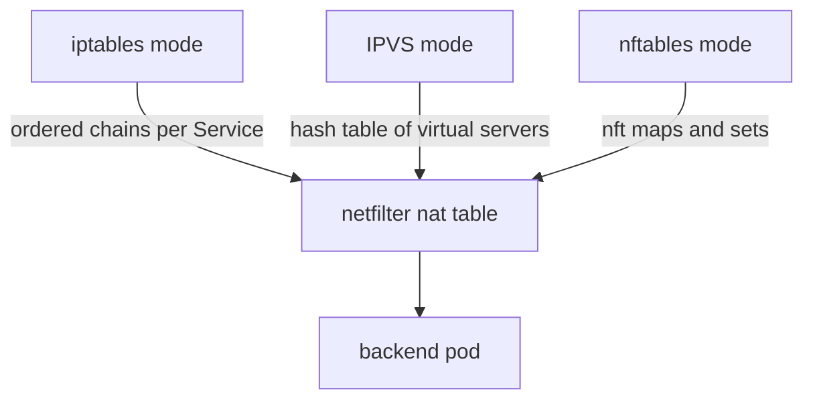

# IPVS And nftables Modes Of kube-proxy

The scaling limits of the iptables mode led the Kubernetes project to add other kube-proxy modes. If you only know the iptables mode, you cannot judge what these modes fix and what they leave open. This part explains the IPVS mode and the nftables mode, shows how to find out which mode a cluster uses, and states what stays the same in every mode.

## What stays the same

In every mode kube-proxy runs on each node, watches Services and EndpointSlices through the Kubernetes API, and programs the kernel so that a Service address reaches a backend pod. The kernel does the packet work. kube-proxy only writes the rules or the tables. The mode is set in the kube-proxy configuration with the field `mode`. When the field is empty, kube-proxy uses the iptables mode on Linux.

## The IPVS mode

IPVS (IP Virtual Server) is a Layer 4 load balancer inside the Linux kernel. It is built on netfilter, and it stores its Services in a hash table. In the IPVS mode, kube-proxy creates one IPVS virtual server for each Service address and port, and it adds one real server for each backend pod.

The lookup of a Service in a hash table takes the same time for 10 Services and for 10,000 Services. This removes the ordered chain scan of the iptables mode. IPVS also offers several scheduling algorithms. The options include round robin (`rr`), least connection (`lc`), destination hashing (`dh`) and source hashing (`sh`). The iptables mode only offers random selection.

The IPVS mode still uses netfilter for some work. kube-proxy uses a small number of iptables rules and ipset sets for masquerading and for filtering. The kernel modules `ip_vs`, `ip_vs_rr`, `ip_vs_wrr`, `ip_vs_sh` and `nf_conntrack` must be available on each node. IPVS also keeps its own connection table next to the connection tracking table of netfilter.

On a node with the IPVS mode, the command `ipvsadm -Ln` prints the virtual servers and the real servers behind them. The tool `ipvsadm` is not installed on most nodes, so you may have to install it first.

## The nftables mode

nftables is the successor of iptables in the Linux kernel. It uses one rule language and one kernel framework for all protocol families. A rule set in nftables can contain maps and sets, which are keyed lookup structures. With a map, one rule can look up the backend for a Service address and port without a chain for each Service.

The nftables mode of kube-proxy writes a table named `kube-proxy` and uses these maps. It became generally available in Kubernetes 1.33. The kube-proxy project describes it as the successor of the iptables mode, because it updates faster and its lookup time does not grow with the number of Services. It needs a kernel of version 5.13 or newer and the `nft` tool version 1.0.1 or newer in the kube-proxy image.

Because the mode writes to its own table, you read it with a different command. On a node with the nftables mode, `nft list table ip kube-proxy` prints the rules and maps of the IPv4 table.



The diagram shows that all three modes end in the kernel packet path of netfilter, and that they differ in the structure that selects the backend.

## Find the mode of a cluster

The kube-proxy configuration lives in a ConfigMap in `kube-system`. On a cluster that was created with `kubeadm`, the ConfigMap is named `kube-proxy`. Print the mode:

<!-- astrona:playground:renew -->

```sh
kubectl -n kube-system get configmap kube-proxy -o jsonpath='{.data.config\.conf}' | grep -E '^mode:'
```

An empty value after `mode:` means the default, which is the iptables mode. The playground runs kube-proxy in the iptables mode. You can also count the Service chains that the iptables mode creates in the NAT table of a node:

```sh
PROXY=$(kubectl -n kube-system get pods -l k8s-app=kube-proxy -o jsonpath='{.items[0].metadata.name}')
kubectl -n kube-system exec "$PROXY" -- iptables-save -t nat | grep -c KUBE-SVC
```

A count above zero shows that kube-proxy created one chain for each Service port, which is the iptables mode. In the nftables mode the NAT table holds no `KUBE-SVC` chains. In the IPVS mode it holds only a few fixed chains, not one chain for each Service.

## What the other modes do not fix

The new modes change how a backend is found. They do not change the other limits from the previous part. The connection tracking table still has a fixed size. Policy that is based on IP addresses still needs an update for each pod change. A packet still carries no identity of the sender, and the kernel gives no per-flow visibility without extra tools.

For the IPVS mode, kube-proxy also has to keep the iptables and ipset parts in sync. For the nftables mode, the older tools that read iptables rules do not show the Service rules, so scripts and dashboards that parse `iptables-save` stop working. Cilium takes a different path: it does not rewrite the rules in netfilter, and it handles Services in eBPF maps with socket and tc programs.

## What you now know

You know that kube-proxy has an iptables mode, an IPVS mode and an nftables mode, that IPVS and nftables replace the ordered chain scan with a hash table or a map, and that you read the mode from the kube-proxy configuration. You also know that none of the modes adds identity-based policy or per-flow visibility. The next question is what happens to a connection after the translation, because connection tracking decides how the reply finds its way back.

## Common pitfalls

> [!WARNING]
> Do not assume that a cluster uses the iptables mode. Read the `mode` field before you look for rules. A command such as `iptables-save | grep KUBE-SVC` that finds nothing may mean that the cluster uses IPVS or nftables, and not that Services are missing. Check the minimum kernel and tool versions of your Kubernetes release before you change the mode.
