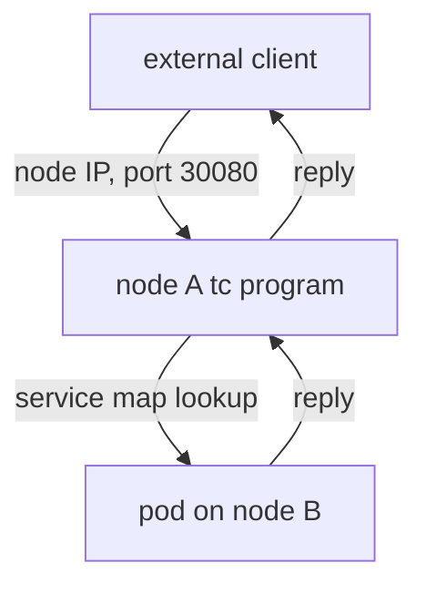

# How Cilium Replaces kube-proxy

kube-proxy has one job: make a Service address reach a pod. Cilium already keeps the Services and the backends in maps for its own load balancing, so it can take over that job completely. This part explains how Cilium handles each kind of Service traffic, which settings turn the replacement on and why one of them needs the address of the API server, and how to check which mode an agent runs in.

## Not the same as in-cluster load balancing

A Cilium installation with the default settings already performs load balancing for the cluster IP of a Service when a pod connects, and kube-proxy handles the rest, such as NodePort. The setting `kubeProxyReplacement` makes Cilium handle all Service types: ClusterIP, NodePort, ExternalIPs and LoadBalancer. In the Helm chart the default value is `false`. When the value is `true`, Cilium requires that the kernel supports all the features it needs and refuses to start the replacement if not, instead of silently using a smaller set.

## How each type of traffic is handled

**ClusterIP from a pod.** The socket program replaces the cluster IP at `connect()` with a pod address. The connection starts with the pod address, and no packet-level NAT is needed.

**NodePort from outside.** A client sends a packet to the address of a node and the node port. A tc program on the node interface, or an XDP program if the driver and the setting allow it, looks up the port in the service map and selects a backend. It rewrites the destination to the pod address and sends the packet to the pod. The node remembers the translation in an eBPF connection tracking map, so the reply goes back through the same node and is translated back.

**NodePort from a pod or from the node itself.** The socket program handles it at `connect()` as for a cluster IP. This also covers a request from a pod to a node port on another node.

By default, the node that receives the packet replaces the source address with its own, so the reply returns through that node even when the backend pod runs on another node. This costs one extra hop for the reply.



The diagram shows that the reply returns through the node that received the request, which is the default behavior with source address translation.

## Direct server return

Cilium can use direct server return (DSR) mode, set with `loadBalancer.mode=dsr`. In this mode the node that receives the request does not change the source address. It passes the packet to the node of the backend pod together with the original destination, and the backend node sends the reply straight to the client. The extra hop for the reply disappears and the client address stays visible to the pod. DSR needs a network that allows the reply to leave from a node that did not receive the request, and it needs a setup in which the node can carry the original destination. It is not the default.

## The settings

Three Helm values matter for the migration.

- `kubeProxyReplacement=true` turns the replacement on.
- `k8sServiceHost` and `k8sServicePort` give Cilium the address and port of the Kubernetes API server.

The last two are needed because of a start-order problem. A pod normally reaches the API server through the Service named `kubernetes`, and that Service is translated by kube-proxy. Once kube-proxy is gone, the translation must come from Cilium, but Cilium needs the API server to learn the Services in the first place. With the address and port of the API server in its configuration, the agent connects directly and does not depend on a Service translation to start.

## Checking the mode

The agent reports what it runs. `cilium-dbg status` has a line that starts with `KubeProxyReplacement`. The Helm value is stored in the `cilium-config` ConfigMap as the key `kube-proxy-replacement`. The command `cilium-dbg service list` prints the Services that the agent handles, and `cilium-dbg bpf lb list` prints the frontends and backends in the map. A Service that appears in the map is handled by Cilium. This is the proof that matters. The Helm value alone is not, because an agent that has not restarted still runs with its old setting.

## Try it on the playground

At the start, the replacement is off and kube-proxy handles Services. Read the status of the agent and the stored setting:

<!-- astrona:playground:renew -->

```sh
kubectl -n kube-system exec ds/cilium -c cilium-agent -- cilium-dbg status | grep KubeProxyReplacement
kubectl -n kube-system get configmap cilium-config -o jsonpath='{.data.kube-proxy-replacement}{"\n"}'
```

Print the Services that the agent knows and the entries in its map:

```sh
kubectl -n kube-system exec ds/cilium -c cilium-agent -- cilium-dbg service list
kubectl -n kube-system exec ds/cilium -c cilium-agent -- cilium-dbg bpf lb list
```

Create a NodePort Service. Save this as `service-probe-nodeport.yaml`:

```yaml
apiVersion: v1
kind: Service
metadata:
  name: probe-nodeport
  namespace: starfleet
spec:
  type: NodePort
  selector:
    app: probe
  ports:
    - name: http
      port: 80
      targetPort: 8080
      nodePort: 30080
```

Apply it:

```sh
kubectl apply -f service-probe-nodeport.yaml
```

Look for the node port in the map. Read the node addresses and test the port from the `drifter` pod. Replace `<NODE_IP>` with one INTERNAL-IP value:

```sh
kubectl get nodes -o wide
kubectl -n kube-system exec ds/cilium -c cilium-agent -- cilium-dbg bpf lb list | grep 30080
kubectl -n outpost exec deploy/drifter -- curl -s -m 5 -o /dev/null -w '%{http_code}\n' http://<NODE_IP>:30080/status/200
```

While kube-proxy handles the NodePort, the agent with the replacement off may not list port 30080 in its map. Whatever your agent shows is the state to record.

## What you now know

With `kubeProxyReplacement` on, Cilium handles ClusterIP at the socket, and NodePort and external traffic in tc or XDP programs with a service map and an eBPF connection tracking table. The API server address and port must be set, because Cilium cannot rely on kube-proxy to reach the API server. The mode is confirmed by the agent status and by the entries in the map. The remaining question is how to move a running cluster to this mode without leaving a broken state.

## Common pitfalls

> [!WARNING]
> Setting the Helm value is not enough: agents read it at start, so they must restart. With `kubeProxyReplacement=true`, an agent on a kernel without the needed features fails to start instead of falling back, which stops networking changes on that node. Check the kernel of every node before you migrate.
