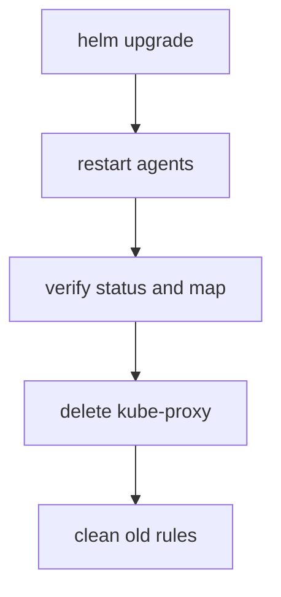

# Migrating A Cluster And Cleaning Up The Old Rules

Turning on the replacement is one step. A running cluster also has a kube-proxy DaemonSet, its ConfigMap and many iptables rules that kube-proxy wrote into every node. Deleting the DaemonSet does not delete the rules, and a stale rule can still match a packet. This part gives the migration order, explains why each step is needed, and lists what stays on the node afterwards.

## The order of the steps

The migration has five steps. The order keeps Services working at each point.

1. Upgrade the Cilium release with `kubeProxyReplacement=true`, `k8sServiceHost` and `k8sServicePort`, with `--reuse-values` so the other settings stay.
2. Restart the Cilium operator and the agents, so that they run with the new settings, and wait until they are ready.
3. Check on every node that the agent reports the replacement and that Services are in the map.
4. Delete the `kube-proxy` DaemonSet and its ConfigMap.
5. Remove the iptables rules that kube-proxy wrote on every node.

Cilium and kube-proxy can run side by side between steps 2 and 4. Both translate the same Service addresses, and the result is the same pod, so nothing breaks. This overlap is the reason to verify before you delete.



The diagram shows the order. The verification happens while kube-proxy is still present, so a failure is cheap to undo.

## Why the old rules must be removed

kube-proxy writes its chains into the `nat` table and a small number of chains into the `filter` table. When the DaemonSet is deleted, nothing removes these rules. They stay in the kernel until the node reboots or someone deletes them. The stale rules are a problem for two reasons. They translate Service addresses to pod addresses that may no longer exist, because nothing updates them, and they cost time for each new connection on the path they still match. For traffic that Cilium handles at the socket, the stale rules do not match, because the destination is already a pod address. For traffic that arrives from outside, a stale rule can match before or after Cilium and give a wrong result.

## How to remove the rules

kube-proxy rules have names and comments that contain `KUBE`. One way to remove them is to save all rules, drop the lines that contain `KUBE` and load the rest again:

```sh
iptables-save | grep -v KUBE | iptables-restore
```

This keeps every rule that does not contain `KUBE`, including those of Cilium. It must run in the network namespace of the node, once for each node. The agent pod uses the network namespace of its node, so running the command in each agent pod reaches the node rules. A node reboot also clears the rules, but a reboot is not a practical way to clean a running cluster.

The command rewrites the whole rule set. A rule of another tool that happens to contain the text `KUBE` is also dropped. Read the output of `iptables-save` before you run it on a node with other software.

## What stays

After the cleanup, the node still has iptables rules. Cilium keeps its own chains, whose names start with `CILIUM`, for a few jobs that it does not do in eBPF in every configuration, for example in setups that need the host firewall or some kinds of masquerading. Whether such rules exist depends on the settings. The goal of the migration is that no `KUBE-SVC`, `KUBE-SEP` or `KUBE-SERVICES` rule remains, not that iptables is empty.

## Failure cases

- The agent does not start after the upgrade. The usual cause is an API server address that is wrong or unreachable from the node, or a kernel that does not support a required feature. Read the agent log and the pod events.
- Services work from pods but not from outside. The agent may run without the NodePort handling because it started before the setting, so check that all agents restarted.
- A node port answers from one node and not from another. Compare `cilium-dbg status` and the map on both nodes.
- Old rules remain on one node because the cleanup ran in only one agent pod. Run it for every agent.

## Try it on the playground

Follow the five steps. First upgrade the release. The control plane node name resolves in a `kind` cluster, so use it as the API server host:

<!-- astrona:playground:renew -->

```sh
helm repo add cilium https://helm.cilium.io/
helm repo update
API_HOST=$(kubectl get nodes -l node-role.kubernetes.io/control-plane -o jsonpath='{.items[0].metadata.name}')
helm upgrade cilium cilium/cilium --version 1.20.2 --namespace kube-system --reuse-values \
  --set kubeProxyReplacement=true --set k8sServiceHost="$API_HOST" --set k8sServicePort=6443 \
  --wait --timeout 300s
```

Restart the operator and the agents and wait:

```sh
kubectl -n kube-system rollout restart deployment/cilium-operator
kubectl -n kube-system rollout restart daemonset/cilium
kubectl -n kube-system rollout status daemonset/cilium --timeout=300s
```

Check the mode and the map while kube-proxy is still there:

```sh
kubectl -n kube-system exec ds/cilium -c cilium-agent -- cilium-dbg status | grep KubeProxyReplacement
kubectl -n kube-system exec ds/cilium -c cilium-agent -- cilium-dbg bpf lb list
```

Delete kube-proxy and its ConfigMap:

```sh
kubectl -n kube-system delete daemonset kube-proxy
kubectl -n kube-system delete configmap kube-proxy --ignore-not-found
```

Remove the old rules on every node. The loop runs the command in each agent pod:

```sh
for agent in $(kubectl -n kube-system get pods -l k8s-app=cilium -o jsonpath='{.items[*].metadata.name}'); do
  kubectl -n kube-system exec "$agent" -c cilium-agent -- sh -c 'iptables-save | grep -v KUBE | iptables-restore'
done
```

Confirm that no kube-proxy rule is left and that the Service still works:

```sh
kubectl -n kube-system exec ds/cilium -c cilium-agent -- sh -c 'iptables-save | grep -c KUBE-SVC'
kubectl -n starfleet exec deploy/shuttle -- curl -s -m 5 -o /dev/null -w '%{http_code}\n' http://probe.starfleet.svc/status/200
```

The count of `KUBE-SVC` lines should be 0. The `grep -c` command exits with a non-zero status when the count is zero, so the shell may report a failure for that command even though the result is the wanted one.

## What you now know

The migration enables the replacement, restarts the agents, verifies the mode and the map while kube-proxy still runs, deletes kube-proxy and then removes its rules from every node. Deleting the DaemonSet does not remove the rules, and the cleanup must reach the network namespace of each node. Some Cilium-owned iptables rules can remain, and they are not a failure.

## Common pitfalls

> [!WARNING]
> The cleanup command rewrites the whole iptables rule set of the node, and it drops every line that contains `KUBE`. Read the rules first on nodes that run other software. Run the cleanup on every node and not only on one, and delete kube-proxy only after the agents report the replacement and the map holds your Services.
