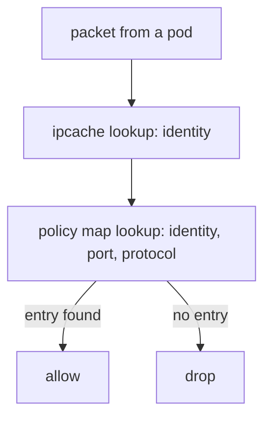

# Network Policy With iptables And With eBPF

A Kubernetes NetworkPolicy says which pods may talk to which pods. The network plugin must turn that object into something the kernel enforces. This part shows the design that iptables-based platforms use, the limits of that design, and the way Cilium enforces the same intent with identities and maps.

## Policy in an iptables-based platform

A platform that builds on iptables turns each policy into rules. A common design creates an ipset, which is a kernel set of addresses, for each label selector, and a chain for each policy. A rule then matches the source address against the ipset and accepts or drops the packet. The platform keeps the ipsets current: when a pod starts, it adds the pod address to every ipset whose selector matches.

This design has three consequences. The decision is based on an IP address, and a pod IP changes when the pod restarts, so the sets must change quickly. Each pod change touches several sets and rules on every node that has a matching pod. And the rule chain for policy is walked in order for each new connection, so many policies mean a longer walk.

## Policy in Cilium

Cilium gives each group of pods with the same labels a numeric security identity. The agent stores the identity of every IP address in the `ipcache` map. A policy rule does not mention addresses. It mentions identities, ports and protocols, and the agent writes each allowed combination as an entry in the policy map of the endpoint.

When a packet leaves or enters a pod, the program on the veth interface looks up the identity of the other side in the `ipcache` map. It then looks up the identity, port and protocol in the policy map of the endpoint. If an entry exists, the packet is allowed. If not, the packet is dropped. Both lookups are map lookups, and neither depends on the number of policies.



The diagram shows two map lookups for each decision: the first translates the address to an identity and the second looks for an allow entry.

A pod that restarts with a new IP address and the same labels keeps its identity. The agent only updates the `ipcache` entry. The policy map does not change.

## Enforcement mode of an endpoint

An endpoint is the Cilium object for a pod. Policy enforcement is off for an endpoint until a policy selects it, when the default mode is used. Once a policy selects an endpoint for ingress, all ingress traffic that no rule allows is dropped. The same is true for egress. The Helm value `policyEnforcementMode` can be `default`, `always` or `never`.

Print the state of the endpoints of a node:

<!-- astrona:playground:renew -->

```sh
kubectl -n kube-system exec ds/cilium -c cilium-agent -- cilium-dbg endpoint list
```

The columns for ingress and egress policy enforcement show `Disabled` or `Enabled` for each endpoint. Without a policy, they should show `Disabled` for the `probe` pods. Create a policy that selects the `probe` pods, and print the list again:

```sh
cat <<'POLICY' | kubectl apply -f -
apiVersion: cilium.io/v2
kind: CiliumNetworkPolicy
metadata:
  name: probe-from-shuttle
  namespace: starfleet
spec:
  endpointSelector:
    matchLabels:
      app: probe
  ingress:
    - fromEndpoints:
        - matchLabels:
            app: shuttle
      toPorts:
        - ports:
            - port: "8080"
              protocol: TCP
POLICY
kubectl -n kube-system exec ds/cilium -c cilium-agent -- cilium-dbg endpoint list
```

The ingress enforcement of the `probe` endpoints on the node now shows `Enabled`. To read the allowed entries, take the endpoint ID from the first column and print its policy map:

```sh
kubectl -n kube-system exec ds/cilium -c cilium-agent -- cilium-dbg bpf policy get <ENDPOINT_ID>
```

Replace `<ENDPOINT_ID>` with the number of a `probe` endpoint. The output lists the identities and ports that are allowed. The identity of the `shuttle` pod should appear with the port 8080.

## Where iptables still appears

Cilium does not use iptables to decide policy. On a node, the agent may still install a few iptables chains for other tasks, which a later part lists. Those chains do not carry the policy decision.

## What you now know

An iptables-based platform enforces policy with ipsets and chains that depend on pod IP addresses and grow with the number of policies. Cilium decides with two map lookups, an identity lookup and a policy lookup, and a pod restart changes only the `ipcache` entry. You can read the enforcement state of an endpoint and its policy map. The next question is what happens to the source address of traffic that leaves the cluster.

## Common pitfalls

> [!WARNING]
> A policy that selects a pod switches that pod from allow-all to default-deny for the direction in the policy, so other traffic to it stops. Delete the policy `probe-from-shuttle` after the exercise. Identities change when labels change, so a label edit can change the result of a policy. Endpoint IDs are numbers of one node and differ on the other nodes.
